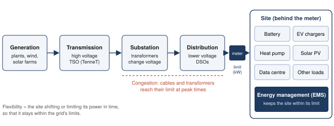
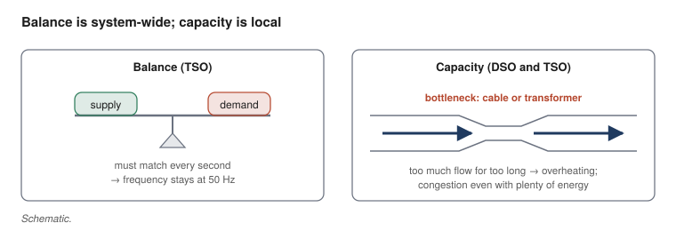
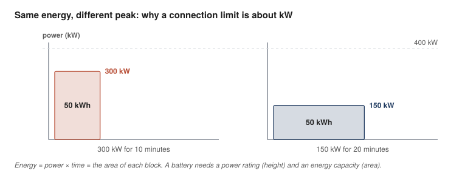
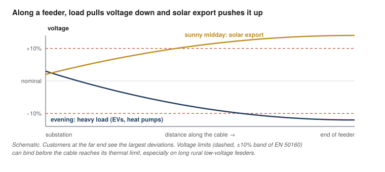
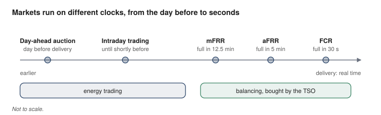
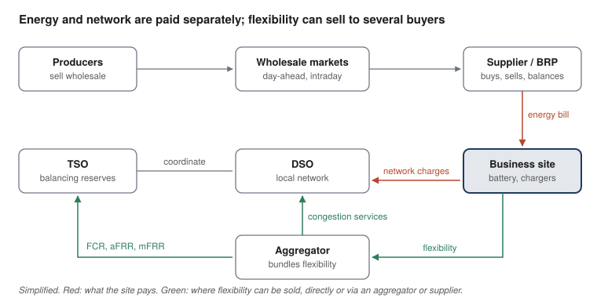

# 2. How the electricity grid works

**In simple terms.** Think of the grid as a road network for electricity. Power stations, wind farms and solar panels put electricity onto the roads; homes, factories, chargers and data centres take it off. Electricity is hard to store along the way, so at every moment what goes in must equal what comes out. And like roads, each cable and transformer can carry only so much at once. When too many users want the same stretch at the same time, there is a traffic jam: that is grid congestion.

## 2.1 The layers of the grid

- **Generation**: power plants, wind and solar farms, and increasingly rooftop solar on homes and businesses.
- **Transmission**: the high-voltage "motorways" that carry power over long distances, run by the transmission system operator (TSO), which is TenneT in the Netherlands.
- **Distribution**: the medium- and low-voltage "local roads" that bring power to neighbourhoods and businesses, run by distribution system operators (DSOs) such as Liander, Stedin and Enexis.
- **Substations and transformers** connect the layers by changing the voltage. They are often where the bottleneck is.

*Figure 1. From power plant to site: the grid layers, where congestion occurs, and the assets behind the meter.*

## 2.2 Balance and capacity: two different problems

- **Balance** is a system-wide problem: supply and demand must match every second, which keeps the grid frequency at 50 Hz in Europe. The TSO handles this with reserves that can ramp up or down quickly.
- **Capacity** is a local problem: a cable or transformer overheats if it carries too much power for too long, so the operator must keep flows below its limit. This is what congestion means.

Congestion can happen even when there is plenty of electricity in the system. The problem is transporting it to where it is needed at that moment, not producing it.

*Figure 2. Balance is a system-wide problem solved by the TSO; capacity is a local problem at a specific cable or transformer.*

## 2.3 Power and energy: kW versus kWh

**Power** (kW) is the rate at which electricity flows, like how many cars pass per minute. **Energy** (kWh) is the total amount over time, like how many cars pass in a day. A grid connection is a limit on power. A battery has both: a power rating (how fast it can charge or discharge) and an energy capacity (how long it can keep going). For example, a 300 kW fast charger running for 10 minutes uses 50 kWh. Sizing a battery means getting both numbers right.

A second example makes the difference concrete. A 300 kW charger running for 10 minutes and a 150 kW charger running for 20 minutes both deliver 50 kWh, because energy is power multiplied by time (300 × 10/60 = 150 × 20/60 = 50). Only the first, however, pushes the site 150 kW closer to its connection limit (Figure 3).

*Figure 3. Same energy, different peak. A grid connection limits the height of the block (kW), not its area (kWh).*

### Voltage, current and three-phase power

Electric power is voltage multiplied by current. European grids use alternating current (AC), which reverses direction 50 times a second, and distribute it in three phases. For a balanced three-phase connection, P = √3 × V × I × cos φ, where V is the voltage between phases, I the current in each phase and cos φ the power factor (1 when current and voltage are perfectly in step). Cables and transformers heat up with current whether or not the power does useful work, so they are rated in apparent power (kVA) rather than kW.

**Worked example.** A 1 MW charging hub on a 400 V low-voltage connection with cos φ = 1 draws I = 1,000,000 ÷ (1.732 × 400) ≈ 1,443 A in each phase. The same 1 MW at 10 kV medium voltage draws about 58 A. This is why large sites connect at medium voltage through their own transformer, and why the transformer rating is a physical limit: a 630 kVA transformer (an illustrative size) cannot continuously supply much more than 630 kW, whatever the contract says.

### What sets the limit: heat, voltage and redundancy

- **Heat.** Losses in a conductor grow with the square of the current. Above its rating, insulation in cables and transformers ages quickly. Equipment heats up slowly, so short overloads are less harmful than long ones; this is why limits depend on duration, and why a battery that shaves a two-hour peak can matter so much.
- **Voltage.** Current flowing through a cable causes a voltage drop along it, and solar export causes a voltage rise. The voltage at customers' terminals must stay within the limits of the European standard EN 50160, which assesses 10-minute average voltages over a week against a band of ±10% of nominal, with an outer band of +10%/−15% ([EN 50160 technical note, Schneider Electric](https://www.productinfo.schneider-electric.com/pm8000/59834d6446e0fb0001420311/Technical%20note/BM_TechnicalNoteEN50160_0000153756.ditamap/$/C_PQ_EN50160SupplyVoltageVariations_0000153762)). On long feeders, voltage can become the binding limit before the cable reaches its thermal rating (Figure 4).
- **Redundancy (N-1).** Grids are planned so that the outage of any single component, such as a cable or transformer, does not overload the remaining ones ([PESGM 2026](https://index.mirasmart.com/PESGM2026/PDFfiles/PESGM2026-000160.pdf)). In the distribution grid, short interruptions are tolerated to a certain extent as long as they are fixed within a defined time ([German grid development plan](https://netzentwicklungsplan.de/en/node/621)). Part of the physical capacity is therefore held in reserve for failures. A flexible user that can be curtailed when a component fails can, in principle, use some of that reserve, which is one reason grid operators can offer flexible contracts on a "full" grid.

*Figure 4. Voltage along a low-voltage feeder in the evening (load) and at a sunny midday (solar export), schematic. The dashed lines mark the ±10% band.*

## 2.4 Connections and contracts

Every site connects to the grid through a meter and a contract that sets its maximum power in kW. When a business asks for more, the grid operator checks whether the network can carry it; if not, the request goes on a waiting list. Everything on the site's side of the meter (batteries, chargers, heat pumps, solar panels) is called **behind the meter**.

**How the connection is billed: a Dutch example.** A large Dutch consumer pays its grid operator a fixed monthly charge, a charge per kW of **contracted transport capacity** (the maximum it may draw at any moment in a calendar year), a charge per kW of the **highest power actually drawn in each month** (kW max), and a small charge per kWh ([Liander tariffs 2026](https://www.liander.nl/-/media/files/tarieven/grootzakelijk/tarieven-2026/tarieven-voor-aansluiting-en-transport-elektriciteit-2026_2.pdf)). For a medium-voltage connection between 136 and 2,000 kW, Liander's 2026 tariffs are €2.29 per kW per month for contracted capacity and €3.57 per kW per month for the monthly maximum, excluding VAT. A battery that lowers the monthly peak by 100 kW in every month therefore saves 100 × 3.57 × 12 ≈ €4,300 a year, and lowering the contracted capacity by the same 100 kW saves another 100 × 2.29 × 12 ≈ €2,700. These network savings are modest; in congested areas the larger value of flexibility often comes from getting a connection at all, or a larger one, years earlier (Section 2.7).

## 2.5 Why congestion is growing

- **Electrification** adds demand: electric vehicles, heat pumps, electric industrial processes and data centres.
- **Solar and wind** add supply in places and at times the grid was not designed for, such as sunny middays in rural areas.
- **Peaks overlap**: many people charge cars and heat homes in the evening, and all solar panels produce at the same time.
- **Building new grid is slow**: new cables and substations take many years to plan, permit and build.

## 2.6 Who does what, and how money flows

Electricity is traded separately from the grid that carries it, and each player has a distinct role:

| Player | Role |
| --- | --- |
| Producers | Generate electricity and sell it on wholesale markets |
| Suppliers | Buy electricity wholesale and sell it to homes and businesses |
| Balance responsible parties (BRPs) | Must keep their portfolio's supply and demand matched for every settlement period; deviations are settled at an imbalance price set by the TSO |
| Aggregators | Bundle flexible assets from many sites and sell their flexibility on markets or to grid operators |
| Grid operators (TSO, DSOs) | Build and run the network, charge network tariffs for connection and transport, and buy services to keep the grid stable |

The wholesale markets work on different timescales:

- **Day-ahead market**: an auction the day before delivery sets a price for each hour or quarter-hour.
- **Intraday market**: continuous trading until shortly before delivery, to correct positions as forecasts change.
- **Balancing**: the TSO buys reserves that react within seconds to minutes. In Europe these are frequency containment reserve (FCR), automatic frequency restoration reserve (aFRR) and manual frequency restoration reserve (mFRR). FCR reacts to the grid frequency itself and must be fully activated within 30 seconds ([Elia](https://www.elia.be/electricity-market-and-system/system-services/keeping-the-balance/activation-for-balancing)); the European platforms for aFRR (PICASSO) and mFRR (MARI) use full activation times of 5 and 12.5 minutes ([Swissgrid](https://swissgrid.ch/content/dam/swissgrid/about-us/newsroom/positions/20250401-Factsheet-Regelenergieplattformen-en.pdf)).

*Figure 5. The markets on a time line, from the day-ahead auction to balancing reserves that react within seconds (not to scale).*

A business pays two separate bills: one to its supplier for energy, and network charges to its grid operator for the connection and transport.

*Figure 6. Who pays whom, simplified. The site pays for energy and for the network separately; its flexibility can be sold to the TSO, the DSO or the market, directly or through an aggregator or supplier.*

## 2.7 How flexibility earns money

| Value stream | What the site does | Who pays or saves |
| --- | --- | --- |
| Earlier or larger connection | Stays within a reduced or time-dependent limit instead of waiting for grid reinforcement | The business: avoided waiting, lost revenue and reinforcement costs |
| Lower network charges | Reduces its peak power where tariffs depend on peak demand | The business |
| Energy arbitrage | Charges or consumes when prices are low, discharges or reduces when prices are high | The market, via price differences |
| Balancing services | Offers fast up or down regulation (FCR, aFRR) | The TSO |
| Congestion management | Reduces or shifts use at a specific location when called, for example under Dutch capacity-steering contracts or through [GOPACS](https://www.gopacs.eu), the Dutch grid operators' congestion platform | The grid operator |
| Imbalance reduction | Helps its balance responsible party stay balanced | The supplier or BRP |

The same battery can earn from several streams; this is called **revenue stacking**. The catch is that capacity promised to one stream (for example a grid limit) cannot be used for another (for example trading), so every site must decide how much flexibility to commit where. Doing that well depends on knowing how much flexibility is reliably available, which is the central question of this guide.

## 2.8 Where flexibility fits

The grid is built for the busiest moments, so most of the time it has spare room. **Flexibility** means shifting or limiting electricity use in time so that peaks fit within the limits: a battery charges when the grid is quiet, chargers slow down at peak times, a heat pump preheats a building earlier, solar output is briefly reduced, or a data centre delays some computing jobs. Flexible connection contracts let a site connect sooner in exchange for staying within lower limits at certain times. The rest of this guide is about how to know, and promise, how much flexibility a site can reliably deliver.
