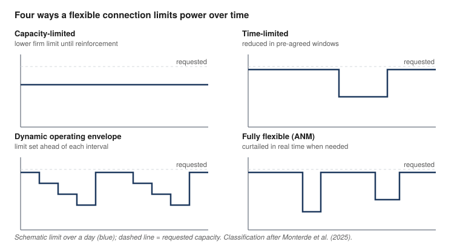

# 3. Grid congestion and flexible connection agreements

**In simple terms.** In many regions the grid is full, so new or growing users wait years for a connection. Instead of a fixed connection that is always available (a "firm" connection), grid operators now offer flexible contracts: you get power sooner, but at certain hours or when the grid is stressed you must stay below a lower limit. This chapter explains the contract types, the laws behind them, and why few businesses sign them yet.

Flexible connection agreements have moved from UK pilots to EU law in about a decade, but regulators, grid operators and researchers all report that practical uptake is limited and poorly understood.

## 3.1 The congestion problem

In the Netherlands, about 15,000 requests for a connection or more transport capacity were waiting at the end of 2025, and the government's IBO report estimates the societal damage of congestion at €10–40 billion a year ([Fieldfisher](https://www.fieldfisher.com/en/insights/legislative-developments-in-the-combat-against-e-grid-congestion-in-the-netherlands)). The problem is international: connection queues exist in at least 16 EU countries ([European Commission](https://energy.ec.europa.eu/topics/infrastructure/european-grids_en)), Germany's congestion-management costs rose to about €3.1 billion in 2025 from €187 million a decade earlier ([Vireo × HTGF](https://www.htgf.de/european-grid-deep-dive/)), including about €3.06 billion for redispatch ([Bundesnetzagentur](https://www.bundesnetzagentur.de/SharedDocs/Pressemitteilungen/EN/2026/20260527_agnes.html)), and about 2,060 GW of generation and storage was waiting to connect in the US at the end of 2025 ([Berkeley Lab](https://emp.lbl.gov/queues)).

## 3.2 Types of flexible connection

A 2025 review by Monterde, Alvarez and Valarezo classifies non-firm connections into four types ([Current Sustainable/Renewable Energy Reports, 2025](https://doi.org/10.1007/s40518-025-00268-7)):

| Type | How the limit works | Example |
| --- | --- | --- |
| Capacity-limited | Firm access below the requested capacity until reinforcement | Interim connections pending grid upgrades |
| Time-limited | Firm access except in pre-agreed windows, usually peaks | Dutch time-block and time-dependent transport rights |
| Dynamic operating envelopes | Import/export limits that vary with forecast conditions, sent before each interval | Australian DOEs |
| Fully flexible (active network management) | Real-time curtailment by rules such as last-in-first-out or pro-rata | UK Flexible Plug and Play |

The same review identifies the UK as the most mature framework, after Ofgem's 2022 Access Significant Code Review standardised non-firm access, and notes that Germany's legal basis includes EnWG §14a, §17(2b) and EEG §8a.

*Figure 7. The four types of flexible connection as a limit over one day (schematic). Moving from top left to bottom right, the limit becomes less predictable for the site, which is why reliability becomes harder to promise.*

## 3.3 Regulation in Europe

Directive (EU) 2024/1711 requires national regulators to set up a framework for grid operators to offer flexible connection agreements where capacity is short, including for energy storage ([Art. 6a](https://eur-lex.europa.eu/eli/dir/2024/1711/oj/eng)). A June 2026 CEER survey lists 14 responding countries with flexible connection set-ups, and finds them offered mainly to consumers and storage. Typical limits include 10% of expected annual demand or up to 876 hours a year, and only five countries (AT, BE, DK, DE, NL) give reduced network charges ([CEER, Grid Connection Capacity Challenges, 2026](https://www.ceer.eu/wp-content/uploads/2026/06/GridConnectionChallanges_CEER-paper-combined-1.pdf)).

Germany has taken a distinctive route at low voltage. Since 1 January 2024, new controllable devices above 4.2 kW, such as heat pumps and wallboxes, must accept being dimmed: the grid operator may temporarily reduce their draw to 4.2 kW to avert overload ([Bundesnetzagentur](https://bundesnetzagentur.de/DE/Vportal/Energie/SteuerbareVBE/artikel.html?nn=779422)). In return, the operator may not refuse or delay their connection because of congestion.

In the Netherlands, businesses can choose among time-block, non-firm and time-dependent transport rights, and capacity-steering contracts in which they are paid to reduce use when called. Capacity-steering contracts reached 4.4 GW by mid-2026 ([Solar Magazine](https://solarmagazine.nl/nieuws-zonne-energie/i44986/bedrijven-zetten-massaal-in-op-flexibel-stroomverbruik-om-netcongestie-te-verlichten-4-4-gigawatt-flexvermogen-gecontracteerd)).

The Dutch time-based rights are precise. The **time-duration right** gives a connection on TenneT's high-voltage grid the right to transport for at least 85% of the hours in a year, and the operator announces at the latest a day ahead whether transport will be limited; the **time-block right**, offered on regional grids, gives the right to transport only within time windows agreed with the grid operator ([ACM overview of congestion measures, November 2026](https://www.acm.nl/system/files/documents/overzicht-netcongestiemaatregelen-update-11-november-2026.pdf); [ACM](https://www.acm.nl/nl/node/26014)). Under the non-firm alternative transport right (ATR), where available capacity is set day by day, a business pays no fixed monthly charge for contracted capacity, only for actual use at the regular kW-max tariff ([Netbeheer Nederland product catalogue](https://www.rvo.nl/sites/default/files/2025-04/20241118_NBNL_Overzicht-Flexproducten_Productcatalogus.pdf)). Section 8.2 works through what a time-block contract means for battery size.

## 3.4 Why uptake is limited

A study commissioned by the Dutch Ministry of Economic Affairs found that only 5–10% of completed congestion-management trajectories had led to a contract by the end of 2025 ([BlueTerra & Trinomics, 2026](https://www.tweedekamer.nl/downloads/document?id=2026D33903)). Businesses cited uncertainty about when, how often and at what revenue they would be called; contract terms with high risks; the effort and complexity of substantiating flexibility; and flexibility that is not reliable enough. Realistic flexibility sat mainly in batteries and e-boilers. Enexis reports that voluntary participation "has delivered limited flexible capacity", so mandatory congestion management now applies in more areas ([Enexis Annual Report 2025](https://publications.enexis.nl/annual-report/annual-report-2025/report/dynamic-system-management)).

The regulatory literature identifies matching gaps. Monterde et al. list legal uncertainty over compensation, the absence of harmonised definitions and curtailment metrics, and investor risk from limited access predictability. CEER flags unclear compliance monitoring and sanctions, and recommends simpler contracts for residential users.

**Implication for this research.** The policy instruments now exist, but the user side lacks tools to predict what a contract will mean for a specific site. That is a modelling and decision problem, which Chapters 4 to 9 examine.
