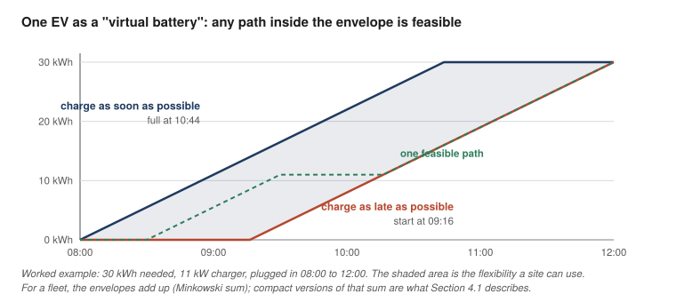
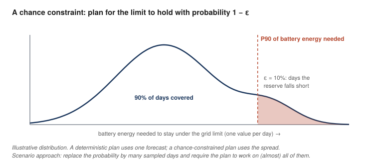

# 4. Quantifying flexibility under uncertainty

**In simple terms.** Flexibility is how much a site can change its power use, up or down, for how long, and when. Measuring it is harder than it sounds: a half-empty battery cannot help for long, and an EV that leaves soon cannot wait. Researchers describe flexibility as the set of power profiles a site could follow, sometimes simplified to a "virtual battery". The key question is not what a site could do in theory, but what it can do reliably, for example nine times out of ten.

The literature has mature tools for describing what a set of devices *could* do, and a fast-growing body of work on what they can do *reliably*. Most of it targets aggregators and system operators, not a single site deciding whether to sign a contract.

## 4.1 Deterministic flexibility representations

Early work defined operational flexibility through three metrics: power capacity, ramp rate and energy capacity. Ulbig and Andersson built on these to quantify and visualise the flexibility of individual units and ensembles with the Power Nodes framework ([PSCC 2014](https://arxiv.org/abs/1312.7618)).

A second stream represents aggregate flexibility as a **virtual battery**. Hao, Sanandaji, Poolla and Vincent showed that a collection of thermostatically controlled loads can be modelled as a generalised battery with dissipation, with power and energy limits derived from device parameters and ambient temperature ([Allerton 2013](https://certs.lbl.gov/publications/generalized-battery-model-collection.html)). Zhao et al. formalised this geometrically: each device's admissible power profiles form a polytope, and the aggregate is their Minkowski sum, approximated by homothets of a prototype battery ([arXiv 1608.04422](https://arxiv.org/abs/1608.04422)).

At TU Delft, Panda and Tindemans proposed a compact representation of the aggregate charging flexibility of EV fleets within a fixed request window, using 2T parameters for T time steps, so that feasibility can be checked and optimised with a small number of constraints ([Electric Power Systems Research, 2024](https://arxiv.org/abs/2310.02729)). Chrysostomou, Rueda Torres and Cremer studied the operational flexibility of active distribution networks at the TSO-DSO boundary under low observability ([arXiv 2304.04192](https://arxiv.org/abs/2304.04192)).

**Worked example: one EV as a virtual battery.** An EV needs 30 kWh, is plugged in from 08:00 to 12:00, and the charger delivers up to 11 kW. Charging as soon as possible finishes at 10:44 (30 ÷ 11 ≈ 2.73 hours); charging as late as possible must start at 09:16. Every energy path between these two curves whose slope never exceeds 11 kW delivers the car on time (Figure 8). The area between them is the flexibility the site controls: here the car can be paused for up to 1 hour 16 minutes in total during a peak. For a fleet, the individual envelopes are added together (a Minkowski sum); the virtual-battery and Panda–Tindemans representations above are compact approximations of that sum.

*Figure 8. The flexibility envelope of one EV. The upper curve charges as early as possible, the lower as late as possible; any path in between is feasible.*

## 4.2 Probabilistic and chance-constrained flexibility

Because baselines, EV arrivals and solar output are uncertain, recent work describes flexibility with a stated probability of delivery:

- **Distributionally robust regions.** Zhang, Zhu and Lu estimate the real and reactive power controllability of aggregated DERs with a data-driven, distributionally robust chance-constrained method, enabling controllability estimation, visualisation and risk quantification ([arXiv 2110.07406](https://arxiv.org/abs/2110.07406)).
- **Stochastic aggregator models.** ETH Zurich work models aggregated DER flexibility with inner and outer power-energy boundaries and formulates the aggregator's operation as chance-constrained programming ([ETH Research Collection, 2024](https://www.research-collection.ethz.ch/entities/publication/63a59b8b-1618-44c4-93a2-6ca29f951521)).
- **Grid-aware probabilistic aggregation.** A 2025 study computes the aggregated flexibility at the grid connection point of an active distribution network with an optimal power flow, using joint chance constraints for several ancillary services at once ([arXiv 2503.15378](https://arxiv.org/abs/2503.15378)).
- **Reliability requirements in markets.** The Danish TSO Energinet requires a minimum 90% reliability for the full availability of reserve bids from stochastic resources. This has prompted chance-constrained bidding models for EV aggregators, including one based on extreme value theory that focuses on the tail where failures occur ([arXiv 2412.02308](https://arxiv.org/abs/2412.02308)).

The last point matters: regulators are beginning to codify probabilistic guarantees ("P90" delivery), which is the same form of promise this research targets for flexible connection contracts.

**Worked example: what a P90 promise means.** Suppose a site records, for each day of a year, the battery energy it would have needed to stay under its grid limit. A deterministic plan uses one forecast, often an average day. A chance-constrained plan chooses the reserve so that the limit holds on at least 90% of days, written as a violation probability ε = 10% (Figure 9). The **scenario approach** makes this computable: sample N possible days and require the plan to work on all of them. For a convex problem with a single decision variable, such as the reserve energy, the classic result is that the chance of the plan failing more often than ε on new days is at most (1 − ε)^N ([Campi, Garatti & Prandini](https://marco-campi.unibs.it/pdf-pszip/Handbook%20MPC.pdf)). With ε = 10% and N = 66 sampled days, 0.9^66 ≈ 0.001, so the plan meets the 90% target with about 99.9% confidence. More decision variables require more samples.

*Figure 9. A chance constraint on an illustrative distribution: the reserve is chosen at the 90th percentile, so the shaded tail (ε = 10% of days) is the accepted risk of falling short.*

## 4.3 Dynamic operating envelopes

On the grid side, **dynamic operating envelopes (DOEs)** give each customer time-varying import and export limits. They have moved to practical implementation in Australia ([Wickramasinghe et al., Modelling, 2025](https://www.mdpi.com/2673-3951/6/2/29)). Research focuses on computing fair, robust envelopes with optimal power flow. Liu and Braslavsky's robust DOEs are explicitly hedged against load and generation uncertainty ([arXiv 2212.03976](https://arxiv.org/abs/2212.03976)), while other formulations use chance-constrained linear OPF with Gaussian forecast errors ([arXiv 2604.17081](https://arxiv.org/abs/2604.17081)).

## 4.4 Assessment

The tools for representing and aggregating flexibility are mature, and probabilistic versions are developing fast. Three limitations remain for this research:

1. Most methods take the perspective of an **aggregator or grid operator** with many devices. Far fewer address a **single site** that must decide, before signing, what limit it can live with.
2. Device models inside these methods are usually **simple linear batteries or thermal models**, with fixed parameters. Uncertainty in the device itself, such as battery state of charge or degradation, is rarely included.
3. DOEs answer "what may the customer do"; this research asks the complementary question, "what can the customer reliably do".
