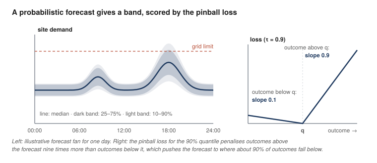

# 5. Modelling site assets

**In simple terms.** To know what a site can do, you need a model of each device: the battery, the chargers, the heat pump, the data centre and the solar panels. A model is a set of equations, or a trained program, that predicts how a device behaves, such as how full the battery really is or how fast a car will charge. This chapter reviews how good these models are today and where they are still uncertain.

Each asset class has its own mature modelling community, but the models are rarely built for use inside a site-level optimiser, and their uncertainty is rarely passed on to the decisions that depend on them.

## 5.1 Batteries: state of charge and state of health

**State of charge.** For LFP cells, the dominant stationary chemistry, the open-circuit voltage is flat over roughly 30–80% state of charge, with hysteresis and path dependence. In a peer-reviewed study, a 5 mV voltage offset produced a state-of-charge error above 20% ([Che, Xu, Teodorescu, Hu & Onori, ACS Energy Letters, 2025](https://pangea.stanford.edu/ERE/pdf/OnoriPDF/Journals/103.pdf)). Field data from a battery analytics vendor reports typical errors of ±15% in LFP systems, with outliers above ±40% ([Accure via ESS News, 2025](https://www.ess-news.com/?p=6558); vendor data).

**State of health.** Machine-learning estimation of state of health is a very large field. A systematic review built a portfolio of 534 papers and found deep learning in 57.5% of implementations, with LSTM networks in 22% ([Sylvestrin et al., Energies, 2025](https://doi.org/10.3390/en18030746)). Two weaknesses recur across reviews:

- **Lab-to-field gap.** A review of 2023–2025 methods concludes that the distance between laboratory validation and field robustness is large ([SAE review, 2025](https://saemobilus.sae.org/articles/a-review-data-driven-approaches-datasets-battery-state-of-health-estimation-14-15-02-0009)). A 2026 review of stationary storage adds incomplete observability, inconsistent health labels and domain shift as barriers to deployment ([Energy Z, 2026](https://www.oaepublish.com/articles/energyz.2025.08)).
- **Missing uncertainty.** Until recently the community focused on deterministic models. A review in npj Materials Sustainability argues for probabilistic machine learning that quantifies prediction uncertainty ([2024](https://pangea.stanford.edu/ERE/pdf/OnoriPDF/Journals/94.pdf)).

Appendix A explains battery chemistry, behaviour, ageing and modelling in depth, including how EV batteries behave when charging.

## 5.2 EV charging

**Demand and behaviour.** EV charging demand forecasting has moved from model-based and probabilistic schemes to machine learning. A 2024 survey notes that learning methods perform poorly with insufficient data, and that data scarcity, privacy, stochasticity and standard metrics are under-addressed ([Rashid, Elfouly & Chen, IEEE OJVT, 2024](https://doi.org/10.1109/ojvt.2024.3457499)). Probabilistic forecasting of charging load, for example predicting quantiles from 0.1 to 0.9, is now an active line of work ([Amara-Ouali et al., WEVJ, 2025](https://doi.org/10.3390/wevj16020088)).

**Charging physics.** Much of the literature assumes EVs draw constant power. In reality, lithium-ion batteries follow constant-current, constant-voltage (CC-CV) profiles with power tapering at high state of charge. Simolin et al. compared measurements of four commercial EVs with different modelling assumptions and showed that the choice matters ([IET GTD, 2022](https://doi.org/10.1049/gtd2.12532)). Recent work combines CC-CV models with state-of-health-dependent power fade, which can cause 20–30% deviations in charging time ([arXiv 2512.06287](https://arxiv.org/abs/2512.06287)).

## 5.3 Heat pumps and buildings

Building thermal modelling has the most advanced physics-informed models of any asset class. Drgoňa et al. encode physics-based priors into a structured recurrent neural network and bound its eigenvalues to guarantee dissipativity, tested on a 20-zone office building ([Energy and Buildings, 2021](https://arxiv.org/abs/2011.05987)). Di Natale et al. introduced Physically Consistent Neural Networks (PCNNs), formally proven to respect physics with respect to control inputs and temperatures, even on unseen data ([Applied Energy, 2022](https://arxiv.org/abs/2112.03212)).

## 5.4 Data centres

Data-centre flexibility is a fast-emerging area. A 2025 review lists protection systems, pre-cooling, CPU/GPU clock rates and smart job scheduling as mechanisms, with job scheduling the most studied, and notes that "comparatively little is understood about its potential scale or cost" ([Current Sustainable/Renewable Energy Reports, 2025](https://link.springer.com/article/10.1007/s40518-025-00258-9)). Field evidence now exists: an AI cluster cut its power by 25% for three hours during a grid peak while maintaining quality of service ([Colangelo et al., 2025](https://arxiv.org/abs/2507.00909)). Modelling remains coarse: most studies represent data-centre flexibility at an aggregate level without capturing how it is realised at the GPU level ([arXiv 2602.05116](https://arxiv.org/abs/2602.05116)), and one study finds flexibility highly price-sensitive, with a 7% reduction for a small incentive but unrealistic prices needed for 33% ([arXiv 2603.27831](https://arxiv.org/abs/2603.27831)).

## 5.5 Solar

Solar matters for flexibility because it produces at the same time everywhere: Germany saw 573 hours of negative wholesale prices in 2025, up from 457 in 2024 ([Vireo × HTGF](https://www.htgf.de/european-grid-deep-dive/)). Solar forecasting is a mature field with established probabilistic methods. For this research, solar is treated as uncertain generation that can be curtailed, using existing forecasts and their error distributions rather than developing new forecasters.

## 5.6 Probabilistic forecasting

**In simple terms.** A point forecast says "tomorrow's evening peak will be 900 kW". A probabilistic forecast says "with 90% probability it will stay below 1,000 kW". A promise with a stated reliability needs the second kind, because the risk sits in the tail, not in the average.

Probabilistic forecasts take several forms: quantiles (for example the 10th, 50th and 90th percentiles), prediction intervals, full predictive distributions, and **scenarios**, which are sample paths over the whole horizon. Scenarios matter for batteries because the energy needed depends on demand over consecutive hours, so the errors of neighbouring hours must stay correlated. Research interest in probabilistic energy forecasting took off in the 2010s; the Global Energy Forecasting Competition 2014 had four probabilistic tracks (load, price, wind and solar) and attracted 581 participants from 61 countries ([Hong et al., International Journal of Forecasting, 2016](https://doi.org/10.1016/j.ijforecast.2016.02.001)). Its score was the pinball loss averaged over 99 quantiles ([arXiv 2408.04405](https://arxiv.org/abs/2408.04405)).

**Worked example: the pinball loss.** For a quantile level τ, forecast q and outcome y, the loss is τ × (y − q) when y ≥ q, and (1 − τ) × (q − y) when y < q. Take τ = 0.9 and a forecast of 1,000 kW. If the outcome is 1,100 kW, the loss is 0.9 × 100 = 90; if it is 900 kW, the loss is 0.1 × 100 = 10. Under-forecasting the 90th percentile costs nine times more than over-forecasting it, so minimising this loss drives the forecast to the level that about 90% of outcomes fall below (Figure 10). Training a model with this loss is called quantile regression.

**Calibration before sharpness.** A good probabilistic forecast is first **calibrated**: when it states a 90% quantile, the outcome should fall below it on about 90% of occasions. Among calibrated forecasts, the **sharpest** (narrowest) is the most useful. Gneiting, Balabdaoui and Raftery formalised this as maximising sharpness subject to calibration ([Journal of the Royal Statistical Society B, 2007](https://doi.org/10.1111/j.1467-9868.2007.00587.x)). For this research the point is practical: a P90 grid promise is only as good as the calibration of the forecast tail it rests on, so calibration must be checked on site data, separately for EV arrivals, energy per session and departure times.

*Figure 10. Left: an illustrative probabilistic forecast of site demand. Right: the pinball loss for the 90% quantile.*

## 5.7 Assessment

| Asset | Model maturity | Physics-informed models | Uncertainty passed to control |
| --- | --- | --- | --- |
| Battery (state of health) | High, but lab-focused | Emerging (see Section 6) | Rare |
| Battery (state of charge) | High for estimation | Limited for LFP | Rare (Brändle and Hug, Section 7.2, are an exception) |
| EV charging | Medium | Rare; constant-power assumption common | Partial (probabilistic demand) |
| Heat pumps and buildings | High | Most advanced (PCNN, Drgoňa) | Partial |
| Data centres | Low, fast-growing | Very limited | Rare |

The common gap is that asset models and their uncertainty are developed in isolation, not as composable blocks with a shared interface for site-level planning and control.
