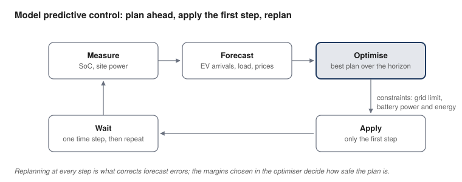
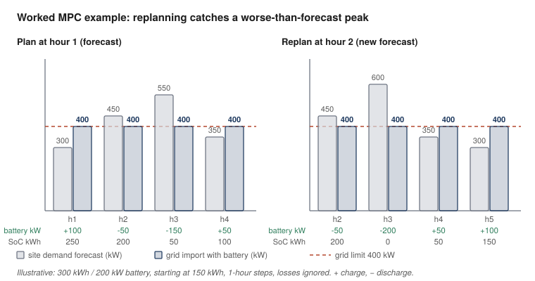
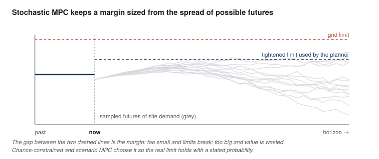
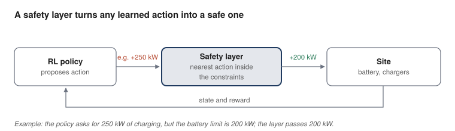

# 7. Optimisation and control under uncertainty

**In simple terms.** Once you have a model, a controller decides what to do at each moment: charge the battery now or later, slow the chargers or not. The standard method, model predictive control (MPC), works like a chess player: it looks a few hours ahead, plans the best moves, carries out only the first one, then replans as new information arrives. The hard part is uncertainty. Forecasts and models are never perfect, so the controller needs safety margins without becoming overly cautious. Reinforcement learning, an AI that learns by trial and error, is an alternative but is harder to make safe.

Model predictive control (MPC) is the established method for site energy management. The research frontier is in handling uncertainty with formal guarantees, and in using learning to make controllers faster or easier to deploy without losing constraint satisfaction.

## 7.1 Deterministic scheduling and MPC for behind-the-meter sites

Mixed-integer and economic MPC formulations for batteries, solar and EV charging are well established. Examples include MPC that reduces demand charges while increasing solar self-use ([Raoufat et al., ISGT 2018](https://arxiv.org/abs/1712.06787)), block MPC that decomposes demand charges into stage costs for EV charging across several stations ([IEEE T-ASE, 2024](https://par.nsf.gov/servlets/purl/10527774)), and joint price-and-power MPC for workplace charging, which in Monte Carlo simulation significantly reduced operator costs using a time-series forecast ([Cambronne et al., 2025](https://arxiv.org/abs/2507.12703)). At TU Delft, Vermeer, Chandra Mouli and Bauer combined optimal sizing and moving-horizon control of a PV-EV-battery charger with frequency reserve and battery degradation ([IEEE OJIES, 2022](https://doi.org/10.1109/OJIES.2022.3161091)).

These formulations usually treat forecasts as exact and device models as known, and handle errors through re-optimisation.

**How MPC works, step by step.** At every time step the controller measures the current state, updates its forecasts, solves an optimisation over a horizon of several hours, applies only the first decision, and repeats (Figure 12).

*Figure 12. The model predictive control loop.*

**Worked example (illustrative).** A site has a 400 kW grid limit and a 300 kWh / 200 kW battery holding 150 kWh; time steps are one hour and losses are ignored. Forecast demand for the next four hours is 300, 450, 550 and 350 kW. To stay under 400 kW the battery must supply 50 kWh in hour 2 and 150 kWh in hour 3: 200 kWh in total, more than the 150 kWh it holds. The optimiser, set here to keep the battery as full as possible, therefore charges 100 kW in hour 1 (300 + 100 = 400 kW; any value from 50 to 100 kW would respect the limit), discharges 50 and 150 kW in hours 2 and 3, and recharges 50 kW in hour 4 (Figure 13, left). Only the first step, charging at 100 kW, is applied.

One hour later the forecast for hour 3 has risen to 600 kW. Following the old plan would import 450 kW in hour 3 and break the limit. The new plan discharges 200 kW in hour 3, the battery's full power, and still holds the limit, ending that hour empty (Figure 13, right). Replanning saved the limit, but with zero margin: a slightly larger forecast error would have broken it. Handling that risk deliberately is what stochastic MPC (Section 7.2) is for.

*Figure 13. The worked MPC example. Grey bars are forecast site demand, blue bars the resulting grid import; the rows below give battery power and state of charge after each hour.*

### The site scheduling problem, written out

Behind every MPC step sits an optimisation problem. For a site with a battery, EV chargers, other load and solar, a standard formulation over time steps t = 1 … T of length Δt is:

- **Decisions:** battery charging power p\_c(t) ≥ 0 and discharging power p\_d(t) ≥ 0, EV charging power p\_ev(t), and the resulting grid import g(t).
- **Power balance:** g(t) = L(t) + p\_ev(t) + p\_c(t) − p\_d(t) − PV(t), with L the other site load and PV the solar output.
- **Grid limit:** g(t) ≤ G(t), where G(t) is the contract limit at time t: constant for a firm contract, lower in the blocked windows of a time-block contract.
- **Battery energy:** E(t+1) = E(t) + (η\_c × p\_c(t) − p\_d(t) ÷ η\_d) × Δt, with charging and discharging efficiencies η\_c and η\_d, and E\_min ≤ E(t) ≤ E\_max.
- **Power limits:** 0 ≤ p\_c(t) ≤ P\_c,max and 0 ≤ p\_d(t) ≤ P\_d,max, which in reality depend on state of charge and temperature (Appendix A.3).
- **EV deadlines:** each car receives its required energy within its plug-in window, inside the envelope of Section 4.1.
- **Objective:** minimise the energy cost (price × import), peak-related network charges, a degradation cost per kWh of throughput, and a penalty for energy not delivered to EVs.

All of these relations are linear, so the problem is a linear programme, which solvers handle efficiently. One subtlety: with losses and positive prices it rarely pays to charge and discharge at the same time, but with negative prices it can, and preventing it then needs binary variables, which turns the problem into a mixed-integer linear programme (MILP).

**From deterministic to chance-constrained.** In the stochastic version, L(t), PV(t) and EV demand are uncertain, and the grid limit becomes P\[g(t) ≤ G(t)\] ≥ 1 − ε. There are two common ways to make this solvable. The scenario approach enforces g(t) ≤ G(t) for each of N sampled scenarios (Section 4.2). A tightened constraint enforces g(t) ≤ G(t) − m(t) on the forecast, where the margin m(t) is a quantile of the forecast error (Figure 14). Brändle and Hug's result (Section 7.2) shows why uncertainty in E(t) itself must also enter m(t).

**Worked example: the degradation cost.** A simple way to price wear divides the battery's replacement cost by the energy it can deliver over its life. A 1 MWh battery costing €200,000 and rated for 6,000 full cycles (illustrative values) delivers about 6,000 MWh, so each MWh discharged costs about €33 of wear. For comparison, Xu notes that a battery at $200/kWh with a 2,000-cycle life gives an amortised cost of a full cycle of around $100/MWh ([arXiv 2011.08425](https://arxiv.org/abs/2011.08425)). A trade whose price spread is smaller than this cost destroys value even if it looks profitable. More accurate models price each cycle by its depth, for example with the piecewise-linear cycle-ageing cost of Xu et al., which can be embedded directly in dispatch optimisation ([arXiv 1707.04567](https://arxiv.org/abs/1707.04567)).

## 7.2 Stochastic, scenario-based and chance-constrained MPC

Stochastic MPC replaces hard constraints with chance constraints that must hold with a given probability. Because chance constraints are generally hard to handle, the **scenario approach** replaces them with a finite number of sampled constraints, with bounds on how many samples are needed for a guarantee ([Campi, Garatti & Prandini, Handbook of MPC](https://marco-campi.unibs.it/pdf-pszip/Handbook%20MPC.pdf)). Extensions include closed-loop bounds on constraint violations ([Schildbach et al.](https://arxiv.org/abs/1307.5640)), recursively feasible formulations using scenario-based probabilistic reachable sets ([Hewing & Zeilinger, 2020](https://research-collection.ethz.ch/bitstream/20.500.11850/389523/1/main.pdf)), and scenario bounds for systems whose dynamics are only approximately known ([Micheli & Lygeros, 2022](https://arxiv.org/abs/2207.12517)).

Applications to energy management are growing:

- **Data-driven chance constraints.** Researchers at ETH Zurich and ABB Corporate Research combined forecasting with data-driven, non-parametric chance constraints that need no assumed probability distribution, trained on three weeks of data ([Babić et al., Frontiers in Control Engineering, 2023](https://www.frontiersin.org/articles/10.3389/fcteg.2023.1237759)).
- **Battery scheduling.** Ghosh et al. place chance constraints on battery state of charge under forecast uncertainty and address the over-conservatism of earlier formulations ([arXiv 2406.01973](https://arxiv.org/abs/2406.01973)).
- **Battery state uncertainty.** Brändle and Hug show that ignoring state-of-charge estimation error in battery bidding causes reserve shortfalls in 92.7% of hours, while a fixed margin cuts revenue by about a third; their margins are tuned heuristically without a probabilistic guarantee ([arXiv 2604.12594](https://arxiv.org/abs/2604.12594)).

Figure 14 shows the idea behind all of these methods: instead of one forecast, the controller considers many possible futures and plans against a tightened limit, so that the real limit holds with a chosen probability. The margin between the two limits is the price of reliability, and choosing it well is the core technical problem of this guide.

*Figure 14. Stochastic MPC plans against a tightened limit sized from the spread of possible futures (schematic).*

## 7.3 Learning-based MPC

Two lines of work use learning to make MPC cheap enough for embedded or large-scale use:

- **Approximate MPC.** Karg and Lucia showed that deep ReLU networks can exactly represent the piecewise-affine MPC law for linear systems, and that approximated controllers run on low-power embedded devices ([IEEE Transactions on Cybernetics, 2020](https://arxiv.org/abs/1806.10644)).
- **Differentiable predictive control (DPC).** Drgoňa et al. learn constrained neural control policies offline by differentiating the MPC loss through a learned system model, without needing an expert MPC to imitate, and report probabilistic performance guarantees ([2020–2024](https://arxiv.org/abs/2004.11184)). They applied DPC to buildings ([arXiv 2107.11843](https://arxiv.org/abs/2107.11843)).

## 7.4 Reinforcement learning and safety

Reinforcement learning (RL) has attracted large interest for EV charging and energy management, but its inability to guarantee safety is the central obstacle. Several 2024–2025 reviews cover safe RL in power systems ([Su et al.](https://arxiv.org/abs/2407.00304); [Yu et al., Renewable and Sustainable Energy Reviews, 2025](https://arxiv.org/abs/2407.00681)); Yu et al. note that safe RL was first applied in power systems in 2020, for EV charging scheduling. A common mechanism is a **safety layer** that projects each proposed action onto the nearest safe action, introduced by Dalal et al. to keep zero constraint violations during learning ([2018](https://arxiv.org/abs/1801.08757)).

*Figure 15. A safety layer between a learned policy and the site. If the policy asks for 250 kW of charging and the battery limit is 200 kW, the layer passes the nearest safe action, 200 kW.*

Comparative evidence favours MPC when a model is available. Arroyo, Spiessens and Helsen found that "even when a model is available and simulation-based RL can be implemented, MPC outperforms RL for an equivalent formulation" ([Frontiers in Built Environment, 2022](https://doi.org/10.3389/fbuil.2022.849754)). A review of 104 papers on field demonstrations of MPC and RL in buildings found real-world deployments rare ([Khabbazi et al., 2025](https://arxiv.org/abs/2503.05022)), and a direct one-month field comparison in an occupied house highlighted safe initialisation and online learning integrity as open problems for RL ([Mulayim et al., 2025](https://arxiv.org/abs/2510.01475)).

## 7.5 Assessment

The methods needed for this research exist individually: MPC for site scheduling, scenario and chance-constrained MPC for probabilistic guarantees, approximate MPC and DPC for speed, and safety layers for learned policies. Two gaps stand out:

1. In the studies reviewed here, chance-constrained formulations usually model uncertainty in **forecasts** (prices, load, solar) but not in the **device models themselves** (battery state of charge and health, EV charging curves, data-centre job flexibility).
2. Few studies connect the operational guarantee to the **contract** a site signs, that is, using the same uncertainty-aware controller in simulation to decide what limit can be promised.
