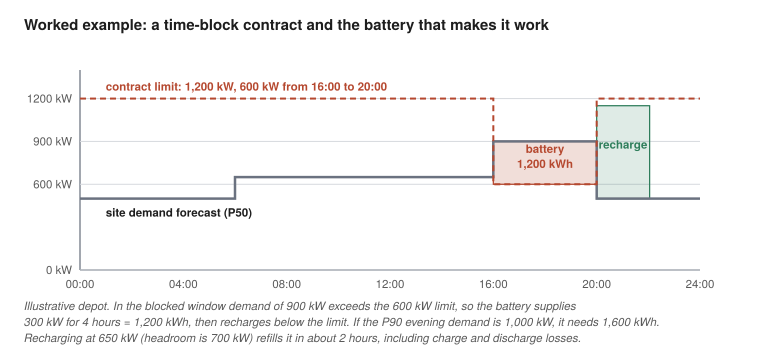
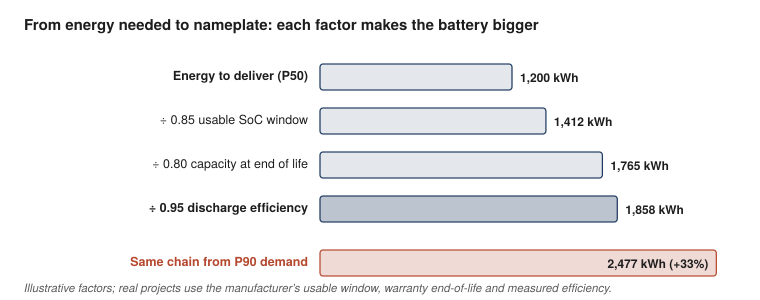
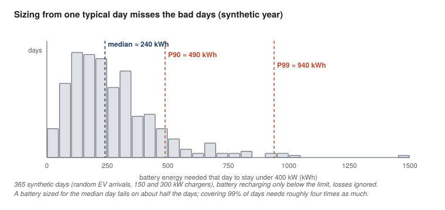
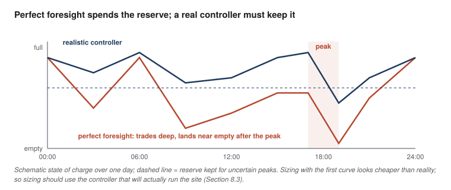

# 8. Planning and sizing under uncertainty

**In simple terms.** Before buying, a business must decide how big a battery to install and which grid contract to sign. Too small, and it breaks the limit; too big, and money is wasted. The usual method is to simulate a year of operation. Many studies assume the future is perfectly known, which makes batteries look better than they really are. This chapter reviews how sizing is done and where it goes wrong.

Choosing a battery size together with a grid contract is an old problem, but most studies size with perfect foresight and fixed tariffs. Recent evidence shows that this overestimates value and tends to oversize batteries, and this review found almost no work that sizes for flexible connection contracts with a stated reliability.

## 8.1 Joint battery and contract sizing

The joint problem is not new: a 1995 paper already determined optimal contract capacities and battery sizes for time-of-use industrial customers of the Taiwan Power Company using dynamic programming ([scilit](https://www.scilit.net/publications/976543fdaf7edf075e061ab556f32ece)). The question has returned with grid connection costs. Ramaschi, Paolone and Leva size both the battery and the grid connection power of EV charging stations, noting that regulators are raising connection costs and that existing studies often overlook them ([IEEE PowerTech, 2025](https://infoscience.epfl.ch/handle/20.500.14299/255415)). Work on capacity-subscription grid tariffs finds the deterministic and stochastic optimal subscribed capacity close for most of 84 metered customers ([arXiv 2111.06253](https://arxiv.org/abs/2111.06253)).

## 8.2 Stochastic sizing of EV and industrial sites

Sizing methods increasingly include uncertainty:

- **Sample-path sizing.** Rouhani, Ardakanian and Musilek generate sample paths of charging-station state and solve a sizing problem for each, to find the smallest battery and PV system that meet service requirements ([IEEE PESGM 2022](https://cs.ualberta.ca/~oardakan/files/PESGM22.pdf)).
- **Heavy-duty depots.** A UCLA framework sizes heavy-duty EV charging stations from depot data with a two-layer uncertainty model for PV, arrival/departure times and charger failures ([World Electric Vehicle Journal, 2025](https://www.mdpi.com/2032-6653/16/6/318)).
- **Two-stage sizing and control.** A two-stage framework sizes the battery with convex optimisation accounting for stochastic charging demand, then runs an RL-based energy management strategy ([TRID](https://trid.trb.org/View/2686018)).
- **Industrial sites.** Work at KIT optimises battery investment and dispatch for industrial companies with a two-stage stochastic model on real load data, concluding that value depends strongly on local grid conditions ([KIT](https://publikationen.bibliothek.kit.edu/1000092749/150532021)).

**Worked example: sizing a battery for a time-block contract (illustrative).** A logistics depot has a time-block contract that allows 1,200 kW, except from 16:00 to 20:00 when it may draw only 600 kW. The median (P50) forecast of its demand in that window is a flat 900 kW, so the battery must supply 300 kW for four hours, 1,200 kWh, and then recharge after 20:00 below the limit (Figure 16).

The 1,200 kWh is the energy to deliver, not the battery to buy. Three factors turn it into a nameplate size (Figure 17):

1. **Usable state-of-charge window.** If the system may be used between 10% and 95% SoC, only 85% of the nameplate is available: 1,200 ÷ 0.85 ≈ 1,412 kWh.
2. **End-of-life capacity.** To keep the promise until the battery has faded to 80% of its original capacity: 1,412 ÷ 0.80 ≈ 1,765 kWh.
3. **Discharge losses.** With 95% one-way efficiency: 1,765 ÷ 0.95 ≈ 1,858 kWh.

The factors are illustrative: real projects take the usable window and end-of-life point from the warranty, and the efficiency from measurements, which vary between systems; one tested 5 MW lithium-ion system showed round-trip efficiencies of 78–85% without auxiliary consumption ([OSTI](https://www.osti.gov/servlets/purl/1406263)).

Now add uncertainty. If the 90th-percentile evening demand is 1,000 kW instead of 900 kW, the battery must deliver 1,600 kWh, and the same chain gives about 2,477 kWh, a third more. Moving from a P50 to a P90 promise is therefore a concrete investment decision, and the right answer depends on the penalty for breaking the limit, which is exactly what Section 4.2 and Chapter 7 provide the tools to quantify.

*Figure 16. The worked example: demand forecast, time-block limit, battery discharge in the blocked window and recharge afterwards.*

*Figure 17. From energy to deliver to nameplate capacity, for the P50 and P90 cases.*

**Worked example: why the distribution matters (synthetic).** Take a simple site with a 400 kW limit, randomly arriving EVs on 150 kW and 300 kW chargers, and a battery that starts each day full and recharges whenever there is room below the limit (battery power limits and losses are ignored). A simulated year of 365 days gives the battery energy needed on each day shown in Figure 18. The median day needs about 240 kWh, the 90th-percentile day about 490 kWh, and the 99th-percentile day about 940 kWh. A battery sized for a typical day would fall short on about every other day; covering 99% of days takes roughly four times as much energy. The numbers come from a toy model and say nothing about any real site, but the shape, a long tail of bad days, is general. This is why sizing should be stated as a probability of meeting the limit, not as one average day.

*Figure 18. Battery energy needed per day over a synthetic year; dashed lines mark the median, P90 and P99.*

## 8.3 The perfect-foresight bias

A consistent finding is that sizing with perfect foresight overestimates what a battery delivers in practice:

- Laws et al. found that perfect forecasts overestimate the value of hybrid PV-battery systems by 1–8% compared with day-ahead forecasts, depending on the dispatch algorithm ([NREL, 2023](https://docs.nrel.gov/docs/fy23osti/86194.pdf)).
- For peak shaving, "prescient" optimisation tends to oversize the battery and underestimate its levelised cost at sizing time, compared with sizing under a realistic rule-based controller ([arXiv 2511.21619](https://arxiv.org/abs/2511.21619)).
- In intraday trading, a forecast-driven strategy earned 11% less than perfect foresight on 2023 German data ([Hornek et al., 2025](https://arxiv.org/abs/2501.07121)).

The implication for planning is direct: the controller used inside the sizing study should be the realistic, uncertainty-aware one that will operate the site, not an idealised optimiser.

Figure 19 shows the mechanism. An optimiser that knows the future can use the battery fully for trading and still arrive at the peak with just enough energy; a real controller must hold a reserve for peaks it cannot predict. Sizing with the first behaviour makes a battery look more capable, and therefore smaller or more profitable, than it will be in operation.

*Figure 19. Perfect foresight versus a realistic controller: schematic state of charge over one day.*

## 8.4 Assessment

Sizing literature has moved from deterministic to stochastic, and has started to include connection costs. Three gaps remain:

1. Sizing is done against **tariffs and demand charges**, not against **flexible connection contracts** with time-dependent limits and call uncertainty.
2. Outputs are expected costs, not the **probability of breaking the contracted limit**, which is what a business and its grid operator need.
3. Few studies close the loop between **the sizing model and the operational controller**, despite evidence that ignoring this leads to oversizing.
