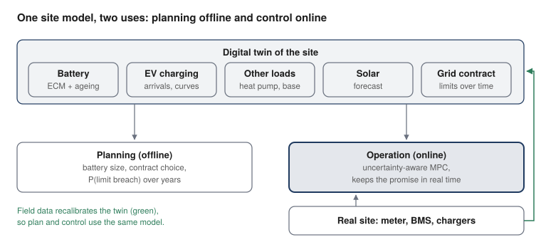

# 9. Digital twins, simulation tools and datasets

**In simple terms.** A digital twin is a virtual copy of a site that behaves like the real one and is fed with real data. On the copy you can test controllers, battery sizes and contracts quickly and safely, before touching the real site. This chapter reviews what the term means, which open-source simulators exist, and which datasets can be reused.

The tooling needed to build and test site-level controllers is largely available as open source, and several key pieces come from TU Delft. What is missing is a simulator that combines physics-informed asset models, realistic forecast errors and flexible contract terms in one place.

## 9.1 Digital twins

"Digital twin" is used loosely in the literature. Zomerdijk, Palensky, AlSkaif and Vergara reviewed definitions and, after consultation with distribution system operators, energy traders and municipalities, proposed a power-system definition that extends NASA's original concept with scenarios and long-term planning ([arXiv 2404.02568](https://arxiv.org/abs/2404.02568)). Cvetković, Palensky et al. identify trans-disciplinarity, different time scales and heterogeneous models as the main challenges, and co-simulation as part of the answer ([Digital Twin, 2022](https://digitaltwin1.org/articles/1-4/v2)). A 2025 TU Delft review covers practices, requirements and data federation for power-system digital twins ([Thwe et al., IEEE Access, 2025](https://doi.org/10.1109/ACCESS.2025.3580055)).

In this research, "digital twin" means a site model built from composable asset models, calibrated on site data and run on forecasts with realistic errors, used both for planning and for testing controllers.

*Figure 20. The digital twin proposed in this guide: one calibrated site model used offline for planning and online for control, with field data feeding back into the model.*

## 9.2 Simulators and benchmarks

| Tool | Scope | Relevance |
| --- | --- | --- |
| [EV2Gym](https://arxiv.org/abs/2404.01849) (TU Delft) | EV smart charging and V2G, with transformers and real data; supports heuristics, MPC and RL | Closest open tool for EV sites |
| [ACN-Sim and ACN-Data](https://arxiv.org/abs/2012.02809) (Caltech) | Workplace charging simulator built on real sessions | Benchmark data and validated scenarios |
| [EV-EcoSim](https://arxiv.org/abs/2401.04705) (Stanford) | Co-simulates EV charging, batteries, PV, transformers and controls | Shows battery controller fidelity can change site planning decisions |
| [CityLearn](https://arxiv.org/abs/2012.10504) | Multi-building districts with batteries, heat pumps, EVs and PV | Standard benchmark for RL and MPC |
| [BOPTEST](https://doi.org/10.1080/19401493.2021.1986574) | Containerised building HVAC test cases with common KPIs | Benchmark for heat-pump and building control |
| [OMLT](https://jmlr.org/papers/v23/22-0277.html) | Embeds neural networks and trees in optimisation models | Links learned models to the optimiser |

EV-EcoSim's finding is especially relevant: the fidelity of the battery controller model "can completely change decisions made when planning an electric vehicle charging site".

## 9.3 Datasets

- **ACN-Data**: over 30,000 workplace charging sessions at the time of publication, growing daily ([Lee, Li & Low, e-Energy 2019](https://ev.caltech.edu/assets/pub/ACN_Data_Analysis_and_Applications.pdf)).
- **Dutch charging data**: an office parking lot in Utrecht with about 300 charging points, covering August 2020 to October 2024, from a project involving ElaadNL ([4TU.ResearchData](https://data.4tu.nl/datasets/80ef3824-3f5d-4e45-8794-3b8791efbd13)). ElaadNL also publishes aggregated open data on public, private and workplace charging ([ElaadNL](https://elaad.nl/en/?p=3630)).
- **Battery ageing**: public long-term cell datasets are widely used in the PIML studies of Section 6, though reviews stress the gap between laboratory and field data.

## 9.4 Assessment

Individual simulators cover EV charging, buildings or districts well, but none combines physics-informed models of all site assets with flexible contract terms and probabilistic evaluation. Building such a twin on top of existing tools, rather than from scratch, is realistic and lowers the risk of the research.
