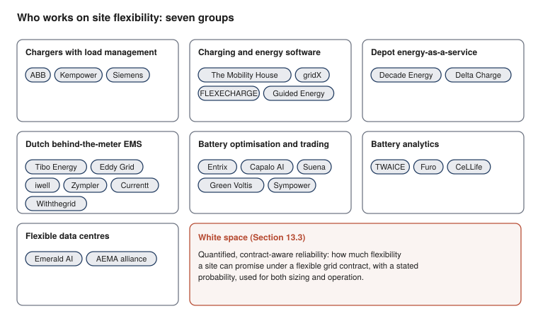

# 11. Startups and companies: who is doing what, and what to learn

**In simple terms.** Many companies already attack grid congestion, each with a different business model: some sell chargers with built-in power management, some sell software, some build and finance whole sites, and some operate batteries in energy markets. This chapter maps who they are, looks closely at the most promising ones, and draws lessons for anyone who wants to work in this space or build a company in it.

## 11.1 The landscape

Europe has a dense ecosystem. Dealroom maps 192 European grid technology startups across 18 segments ([Dealroom](https://dealroom.co/charts/landscape-48597-grid-technology-infrastructure-startups-in-europe.html)). An October 2026 investment thesis by Vireo and High-Tech Gründerfonds maps about 90 European grid startups and asks which grid problems venture-backed startups will solve, and which will be solved by incumbents, infrastructure capital or politics ([Vireo × HTGF](https://www.htgf.de/european-grid-deep-dive/)); it is a useful starting point for further reading.

The players relevant to site flexibility fall into seven groups:

| Group | Examples | Business model | Who pays |
| --- | --- | --- | --- |
| Charger makers with built-in load management | ABB, Kempower, Siemens | Hardware, with load management as a feature | Charge point operators, site owners |
| Charging and energy management software | The Mobility House, gridX, FLEXECHARGE, Guided Energy | Software subscription, sometimes plus energy trading | Fleets, charge point operators |
| Depot energy-as-a-service | Decade Energy, Delta Charge | Design, finance, build and operate the site | Logistics operators, property owners |
| Dutch behind-the-meter EMS and batteries | Tibo Energy, Eddy Grid, iwell, Zympler, Currentt, Withthegrid | EMS software, battery plus EMS, revenue sharing | Commercial and industrial businesses |
| Battery optimisation and trading | Entrix, Capalo AI, Suena, Green Voltis, Sympower | Route-to-market, revenue share, revenue guarantees | Battery owners and investors |
| Battery analytics | TWAICE, Furo, CeLLife | Software as a service | Battery owners, manufacturers |
| Flexible data centres | Emerald AI, with Google and NVIDIA in the AEMA alliance | Software plus performance standards | Data-centre operators |

*Figure 21. The seven groups as a market map, with examples from the table, and the white space this guide identifies.*

## 11.2 Company profiles

| Company | Base | What it does | Reported traction |
| --- | --- | --- | --- |
| The Mobility House | Germany | Hardware-neutral charging and energy management (ChargePilot), plus trading | Manages more than 2,700 fleet charging facilities and trades power from over 1 GWh of storage ([STN, 2026](https://stnonline.com/industry-releases/the-mobility-house-north-america-celebrates-100-megawatts-of-ev-fleet-charging-managing-flexible-capacity-for-a-strained-grid/)); partners with Schneider Electric and FENECON |
| gridX | Germany | Energy management platform for chargers, homes and batteries | Equips DHL Express logistics sites ([The smarter E](https://www.thesmartere.de/news/ai-fleet-charging-dynamic-smart-load-management-solutions)); first pure EMS provider with a G100-compliant gateway in the UK ([gridX, 2026](https://www.gridx.ai/press-releases/gridx-makes-g100-compliant-energy-management-gateway-available-for-households-and-charging-parks-in-the-united-kingdom)) |
| FLEXECHARGE | Denmark | Load, energy and grid management for commercial charging operators | €5 million round in 2025 led by Eneco Ventures and EnBW New Ventures; customers include Electra, Bump and Q8 Benelux; 97 MW of charging capacity connected in 2024 ([FLEXECHARGE](https://www.flexecharge.com/resources/blogs/flexecharge-secures-eu5-million-to-lead-the-flexibility-revolution-in-ev-charging); [EnBW New Ventures](https://www-env-vc-cf.produktion.corp.enbw.com/news/flexecharge-funding-round.html)) |
| Guided Energy | France | Charge management and dispatch for EV fleets | $5.2 million from Sequoia and Dynamo ([TechCrunch, 2024](https://techcrunch.com/2024/02/06/guided-energy-helps-ev-fleet-managers-optimize-battery-charging)) |
| Decade Energy | Europe | Zero-capex depot energy systems: grid connection, battery, chargers, solar and software | €22 million; over 1,500 depot feasibility studies; over 100 projects and 500 MW in development ([Tech.eu, 2026](https://tech.eu/2026/04/23/decade-energy-secures-eur22m-to-electrify-logistics-depots-at-scale/)) |
| Delta Charge | Germany | Charging and battery storage network for electric trucks | Founded 2024, VC-backed ([Munich Startup](https://www.munich-startup.de/en/115012/delta-charge-financing/)) |
| Tibo Energy | Netherlands | AI energy management for commercial and industrial sites | €6 million seed ([Tech.eu, 2025](https://tech.eu/2025/06/30/tibo-energy-raises-eur6m-to-scale-ai-energy-management-platform/)) |
| Eddy Grid | Netherlands | Asset optimisation using distributed batteries | €7.5 million; team grew from 16 to 60; over 500 MW managed; valuation over 20 times that of two years earlier ([IO+, 2026](https://ioplus.nl/en/posts/energy-asset-optimizer-eddy-grid-lands-75-million-)) |
| iwell | Netherlands | Commercial and industrial batteries with integrated EMS | €27 million ([ESS News](https://www.ess-news.com/?p=4980)) |
| Zympler, Currentt, Withthegrid | Netherlands | EMS software and local controllers | €1.5 million ([EU-Startups via BeBeez](https://bebeez.eu/2025/09/05/utrecht-based-cleantech-startup-zympler-powers-up-with-e1-5-million-to-tackle-grid-woes/)); €1.7 million, with control running locally for cybersecurity ([Silicon Canals](https://siliconcanals.com/currentt-secures-e1-7m/)); €3.5 million ([Rabobank](https://www.rabobank.nl/en/business/startups-and-scale-ups/articles/011486589-withthegrid-digitizes-energy-infrastructure-for-a-future-proof-grid)) |
| Entrix | Germany | Battery optimisation and route-to-market; services span sizing, business planning, financing, grid onboarding, market access and live optimisation ([Runtime Wire](https://runtimewire.com/article/startup-spotlight-furo-raises-4m-silicon-valley-munich)) | €43 million; 3 GW / 8.5 GWh contracted; over 70 systems ([Tech.eu, 2026](https://tech.eu/2026/03/25/entrix-raises-eur43m-as-contracted-battery-storage-portfolio-reaches-3gw/)) |
| Sympower | Netherlands | Aggregates industrial flexibility as reserves for grid operators | €19 million Series B1 ([Energy-Storage.news](https://www.energy-storage.news/sympower-and-suena-raise-combined-e27-million-for-european-bess-optimisation-international-expansion/)) |
| Green Voltis | Sweden | AI battery optimisation with revenue sharing and guaranteed minimum revenues; plans to extend to data centres | €13.5 million Series A, November 2026 ([Startbase](https://www.startbase.com/news/green-voltis-erhaelt-135-millionen-euro-fuer-ki-gesteuerte-batteriespeicher-und-rechenzentren/)) |
| Capalo AI | Finland | AI virtual power plant trading batteries and renewables | €11 million Series A ([Tech.eu, 2026](https://tech.eu/2026/02/06/capalo-ai-raises-eur11m-to-expand-battery-storage-optimization/)) |
| TWAICE, Furo | Germany | Battery analytics (TWAICE); software that sizes, controls and trades commercial and industrial batteries (Furo, Munich, founded 2025; [Runtime Wire](https://runtimewire.com/article/startup-spotlight-furo-raises-4m-silicon-valley-munich)) | TWAICE: €24 million EIB financing ([Brussels Times](https://www.brusselstimes.com/1955864/battery-tech-firm-secures-e24m-eib-financing-as-operators-face-growing-strain)); Furo: over 6,000 sites ([Mercom](https://mercomindia.com/furo-raises-4-million-to-expand-battery-optimization-platform)) |
| ADS-TEC Energy | Germany | Battery-buffered fast chargers | Over 3,700 charging points delivered (Section 10.3) |
| Emerald AI | United States | Flexible AI data centres | $150 million raised; co-founder of AEMA (Section 10.4) |

## 11.3 The most promising, up close

**Decade Energy: selling a working site, not software.** Grid connection lead times run to years, and integrating batteries, solar, chargers and grid connections is beyond the core competency of most logistics operators ([The Next Web](https://thenextweb.com/news/decade-energy-22m-electric-trucks-europe)). Decade designs, finances and operates the whole system with no upfront cost to the customer. Its funnel is telling: more than 1,500 feasibility studies have led to over 100 projects. Planning and sizing are the top of the sales funnel, not the product.

**The Mobility House: hardware-neutral scale, then trading.** It controls charging at thousands of sites regardless of charger brand, reaches customers through partners such as Schneider Electric and FENECON, and trades power from the storage it manages. Once you operate many sites, energy markets become a second revenue stream.

**Entrix: operating batteries is where the money is.** With 3 GW contracted, Entrix shows that owners and investors pay specialists to run their batteries across markets. Green Voltis takes this further with guaranteed minimum revenues, which help owners finance new projects.

**Eddy Grid: riding Dutch congestion.** Rapid growth in team, managed capacity and valuation within two years shows how urgent the Dutch market is, and how fast a company combining batteries, energy management and market access can scale there.

**Emerald AI: reliability as the product.** A field demonstration, a large raise and a performance-based industry alliance suggest that proving predictable flexibility in the field, and helping set the standard for it, is a credible way to win the trust of grid operators.

## 11.4 Lessons from the market

1. **Customers buy outcomes.** Businesses want a connected, working, affordable site. Energy-as-a-service and revenue guarantees are growing because they remove complexity and risk.
2. **Money flows to whoever operates the assets.** Among the companies reviewed here, optimisation and trading attract the largest rounds; a pure planning tool is a smaller business unless it feeds into operation.
3. **Distribution beats technology.** Furo sells through installers, project developers, storage manufacturers and energy suppliers ([Mercom](https://mercomindia.com/furo-raises-4-million-to-expand-battery-optimization-platform)); The Mobility House through large partners. A great algorithm without a channel stalls.
4. **Regulation opens doors.** Being first to comply with new rules (gridX in the UK) or to fit new grid-operator contracts (Liander's FlexPlus, Section 10.2) creates an early advantage.
5. **Basic load management is commoditised.** It ships as a standard feature with major chargers (ABB, Kempower, Siemens). Differentiation has to come from somewhere else: financing, market access, or quantified reliability.
6. **Reliability is becoming the currency, but few quantify it.** Grid operators and alliances such as AEMA ask for predictable flexibility, and Energinet already demands 90% reliability for reserves (Section 4.2). None of the companies reviewed here offers a site a stated probability of staying within its contract. That is the clearest white space.
7. **Expect consolidation.** Sympower describes its next chapter as being "all about scale: strategic M&A, deeper BESS integration, and new markets" ([Energy-Storage.news](https://www.energy-storage.news/sympower-and-suena-raise-combined-e27-million-for-european-bess-optimisation-international-expansion/)). Well-funded players are likely to buy specialised technology and teams.

## 11.5 Assessment

The market is crowded at the level of generic energy management and battery trading, and is moving towards integrated, financed offers. The opening is in what integrators, EMS companies and battery optimisers still lack: contract-aware planning and operation with a quantified reliability, especially for EV-heavy sites. The same companies are also the most likely employers, partners, customers and acquirers for anyone with deep skills in this area.
