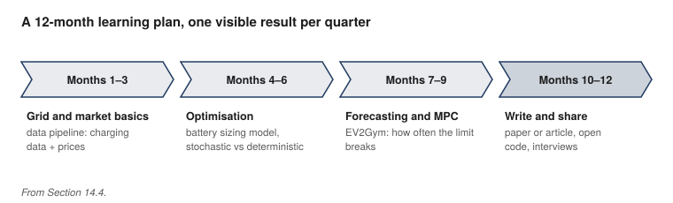

# 14. Skills that pay off

**In simple terms.** The people this space needs most combine three things: understanding of the grid and energy markets, strong technical skills in data, optimisation and control, and the ability to turn these into products that customers buy. Few people have all three, which is why the combination is valuable both for well-paid jobs and for founding a company.

## 14.1 Why these skills are in demand

- At least 40% of energy businesses found it difficult to hire suitably skilled data scientists, and domain knowledge and coding skills were among the most prominent weaknesses ([Energy Systems Catapult](https://es.catapult.org.uk/news/survey-reveals-digital-data-skills-gap-in-the-energy-sector/)).
- In the same survey, 95% of respondents used Python ([Enlit](https://www.enlit.world/library/survey-energy-sector-seeing-major-data-science-skills-gap)).
- Roles tied to grid integration, energy storage and system flexibility are expanding quickly ([IEEE Transmitter, 2026](https://transmitter.ieee.org/?p=20682)).
- In the UK, clean-energy employers increasingly prioritise AI competency over traditional degrees ([Skills England, 2026](https://www.gov.uk/government/publications/skills-england-annual-skills-report-and-sectoral-skills-needs-assessments-2026/sector-skills-needs-assessment-clean-energy)).

## 14.2 The skill map

| Skill | What to learn | Tools and practice | Where it pays |
| --- | --- | --- | --- |
| Grid and regulation | Congestion, connection contracts, grid codes, EU and Dutch rules | Regulator papers (CEER, ACM), this guide | Everywhere; essential for founders and product leads |
| Energy markets | Day-ahead, intraday, balancing and reserves, revenue stacking | ENTSO-E and exchange price data; backtest a battery strategy | Battery optimisers, aggregators, trading |
| Optimisation | LP and MILP, stochastic and robust optimisation | Pyomo or CVXPY with [HiGHS](https://highs.dev) or Gurobi | Optimisation engineer, quantitative roles |
| Probabilistic forecasting and ML | Quantile forecasts, gradient boosting, conformal prediction, time series | scikit-learn, LightGBM, PyTorch | Energy data scientist |
| Control | MPC, stochastic MPC, basics of safe RL | [do-mpc](https://www.do-mpc.com), EV2Gym | EMS and control engineer |
| Battery modelling | State of charge and health, degradation, charging curves | [PyBaMM](https://pybamm.org), public ageing datasets | Battery analytics, storage engineering |
| Physics-informed ML | Grey-box models, neural ODEs, differentiable control | [NeuroMANCER](https://github.com/pnnl/neuromancer), PyTorch | R\&D; a strong differentiator |
| Power-system tools | Load flow, network constraints | [pandapower](https://www.pandapower.org) | Grid operators, consultancies, grid-aware products |
| Software and data engineering | Production Python, APIs, cloud, time-series databases, device protocols such as OCPP and Modbus | Build and deploy a small service | Every product team |
| Business | Customer discovery, battery business cases (payback, IRR), pricing, partnerships, fundraising | Interviews; a financial model of one site | Founders, product leads, business development |

## 14.3 Skill stacks by goal

- **Well-paid technical role**: energy markets, optimisation, probabilistic forecasting and production Python. This is the profile battery optimisers, aggregators and trading teams hire for; trading-adjacent roles are generally among the better-paid in energy (a general observation, not a sourced figure).
- **Product and leadership**: grid and regulation, product management and enough technical depth to lead engineers.
- **Founder**: one deep technical edge (such as quantified reliability), plus customer discovery, financial modelling and distribution partnerships (Section 11.4).

## 14.4 A 12-month learning plan alongside work

1. **Months 1–3**: grid, regulation and market basics; a Python data pipeline on Dutch charging data and day-ahead prices.
2. **Months 4–6**: optimisation; a battery sizing model for a charging site, comparing deterministic and stochastic sizing.
3. **Months 7–9**: probabilistic forecasting and MPC in EV2Gym; measure how often the grid limit would be breached.
4. **Months 10–12**: write it up as a paper or technical article, open-source the code, use it in customer interviews.

Each step produces a visible result, which is proof of skill for employers, professors and investors alike.

*Figure 23. The 12-month plan as a road map.*

## 14.5 Assessment

The scarce profile is neither "AI expert" nor "energy expert" alone, but someone who connects the two and ships products.
