# Appendix A. Batteries in depth

**In simple terms.** A battery is the most important flexible asset on most sites, and an EV is a battery on wheels. To promise flexibility reliably, you need to know how batteries are built, how they behave, why they wear out, and why their state is hard to measure. This appendix covers the essentials, from cell chemistry to how EV batteries behave at a charger, and ends with what it all means for site flexibility.

## A.1 How a lithium-ion battery works

A lithium-ion cell has four main parts: a negative electrode (anode, usually graphite, sometimes with silicon), a positive electrode (cathode, which gives the chemistry its name, such as LFP or NMC), a liquid electrolyte, and a porous separator. During charging, lithium ions move from the cathode through the electrolyte into the anode; during discharge they move back, while electrons flow through the external circuit.

**In simple terms.** A lithium-ion battery is often called a "rocking chair": lithium ions move back and forth between two materials that can store them inside their crystal structure, like books moved between two shelves. Charging pushes the ions to one shelf and discharging lets them return. The electrons cannot cross inside the cell, so they travel the long way round, through the external circuit, and that flow is the electric current.

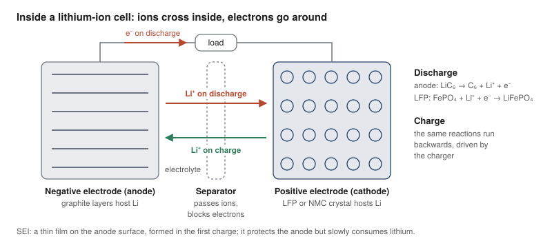

*Figure A1. Inside a lithium-ion cell. Lithium ions cross the electrolyte and separator; electrons travel through the external circuit. Red arrows show discharge, green arrows charge.*

### The chemistry, step by step

**1. Intercalation.** Both electrodes are host materials. Graphite consists of stacked carbon layers, and lithium slots in between them; LFP and NMC are crystals with sites for lithium. Inserting lithium into a host without destroying it is called intercalation, and it is why a lithium-ion cell can be cycled thousands of times.

**2. The half-reactions.** Written for discharge; charging runs them backwards:

- Negative electrode (graphite): LiC₆ → C₆ + Li⁺ + e⁻
- Positive electrode, LFP: FePO₄ + Li⁺ + e⁻ → LiFePO₄, in which iron is reduced from Fe³⁺ to Fe²⁺
- Positive electrode, NMC: Li₁₋ₓMO₂ + x Li⁺ + x e⁻ → LiMO₂, where M stands for the mix of nickel, manganese and cobalt

The ion travels inside the cell; the electron must take the external circuit, and that flow does useful work. The separator lets ions through but blocks electrons. If it fails, electrons take the short way inside the cell: an internal short circuit, which can trigger thermal runaway (Section A.5).

**3. Where the voltage comes from.** Each electrode has a potential measured against lithium metal. Graphite works close to the potential of lithium metal ([EES Batteries, 2025](https://pubs.rsc.org/en/content/articlehtml/2025/eb/d5eb00202h)), LFP at about 3.4 V ([Malik, Abdellahi & Ceder, review](https://web.mit.edu/ceder/publications/2013_LFP_Review_paper.pdf)) and nickel-rich NMC at about 3.8 V ([Sustainable Chemistry review, 2025](https://www.mdpi.com/2673-4079/6/1/7)). The cell voltage is roughly the difference between the two electrode potentials, which is why an LFP cell sits around 3.2–3.3 V and an NMC cell around 3.6–3.7 V (Section A.2). Since energy is charge multiplied by voltage, the higher voltage of NMC is one reason for its higher energy density.

**4. Why the LFP curve is flat.** When LFP is charged or discharged, its particles separate into two phases, a lithium-rich one (LiFePO₄) and a lithium-poor one (FePO₄), and the boundary between them moves ([Malik, Abdellahi & Ceder](https://web.mit.edu/ceder/publications/2013_LFP_Review_paper.pdf)). As long as the two phases coexist, the electrode potential stays almost constant, whatever fraction has been converted. Layered oxides behave differently: the curve of LiCoO₂, whose structure NMC shares, slopes gradually as lithium is removed, whereas the flat LFP profile is characteristic of a two-phase reaction ([electrode materials overview](https://b2b.sigmaaldrich.com/US/en/technical-documents/technical-article/materials-science-and-engineering/batteries-supercapacitors-and-fuel-cells/electrode-materials-for-lithium-ion-batteries)). The consequence for state estimation is direct: voltage is a useful SoC sensor for NMC and a poor one for LFP over most of its range (Figure A2).

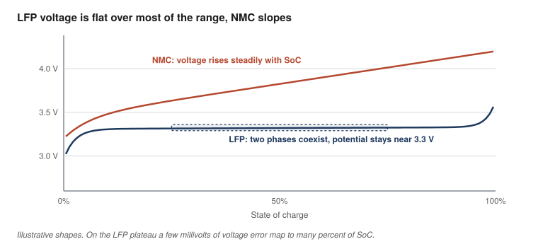

*Figure A2. Open-circuit voltage against state of charge, illustrative shapes. The LFP plateau is why its SoC is hard to read from voltage.*

**5. How much charge a material can hold: a worked example.** Faraday's law links chemistry to amp-hours. One mole of electrons carries 96,485 coulombs, which is 26.8 Ah. One formula unit of LiFePO₄ (molar mass about 157.8 g/mol) releases one lithium ion and one electron, so its theoretical capacity is 26.8 Ah ÷ 157.8 g ≈ 0.170 Ah/g, or 170 mAh/g, the value reported in the literature (Malik et al.). Graphite stores one lithium per six carbon atoms (LiC₆, 6 × 12.01 ≈ 72.1 g/mol), giving 26.8 ÷ 72.1 ≈ 372 mAh/g ([EES Batteries, 2025](https://pubs.rsc.org/en/content/articlehtml/2025/eb/d5eb00202h)). A finished cell stores far less per kilogram than these material values, because current collectors, electrolyte, separator, casing and the need to balance the two electrodes add weight without storing lithium.

**6. The SEI: a protective film that costs lithium.** On the first charge, the graphite potential falls below the level at which the electrolyte is stable. Electrolyte molecules react with lithium ions and electrons and form a nanometre-thick solid layer on the graphite surface, the solid electrolyte interphase (SEI). It protects the electrolyte in later cycles, but it keeps growing slowly and consumes lithium as it does ([von Kolzenberg, Latz & Horstmann](https://publikationen.bibliothek.kit.edu/1000128526/99502733)). This is why new cells go through a controlled formation process at the factory, and why SEI growth is a main source of ageing (Section A.4).

### From cell to pack: a worked example

Cells are combined into **modules** and then into a **pack** (in a vehicle) or **rack** and container (in stationary storage). A **battery management system (BMS)** measures voltages, currents and temperatures, estimates the battery's state, balances cells and enforces safety limits. A **thermal management system** keeps cells in a safe temperature range. Cells come in three formats: cylindrical, prismatic (hard rectangular case) and pouch (soft foil).

Series connection adds voltage; parallel connection adds capacity; energy is capacity multiplied by voltage. Illustrative numbers for a 280 Ah LFP cell at 3.2 V (Figure A3):

- **One cell:** 280 Ah × 3.2 V = 896 Wh, about 0.9 kWh.
- **A module of 16 cells in series ("16S"):** 16 × 3.2 V = 51.2 V at 280 Ah, about 14.3 kWh.
- **A rack of 8 such modules in series:** about 410 V and 115 kWh. A container combines many racks.
- **C-rate:** a 1 MWh system delivering 500 kW runs at 0.5C, about two hours from full to empty.
- **Why voltage matters for power:** 350 kW at 400 V needs 875 A; at 800 V it needs about 438 A. Resistive losses scale with the square of the current, so for the same resistance they fall to a quarter, the main reason for 800 V EV architectures (Section A.8).

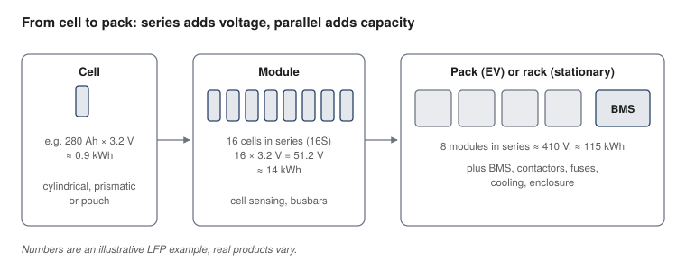

*Figure A3. Cell, module and pack or rack, with the illustrative numbers above.*

### Key terms

| Term | Meaning |
| --- | --- |
| Capacity (Ah) and energy (kWh) | How much charge and energy the battery stores |
| C-rate | Current relative to capacity: 1C fully charges or discharges in about one hour, 2C in about 30 minutes |
| State of charge (SoC) | How full the battery is, in % of usable capacity |
| State of health (SoH) | Remaining capacity (or resistance) relative to new, in % |
| Depth of discharge (DoD) | How much of the capacity is used in a cycle |
| Open-circuit voltage (OCV) | Cell voltage at rest; its link to SoC is used to estimate how full the battery is |
| Internal resistance | Causes voltage drop, heat and power limits; grows with age |

### What the battery management system does

The BMS is the battery's brain and its safety guard. It has five jobs:

1. **Measure** every cell voltage (or every group of parallel cells), the pack current and temperatures at many points.
2. **Estimate** state of charge, state of health and available power (Section A.6), and report them to the system it serves: a vehicle, an inverter or a site controller.
3. **Protect** by opening contactors when a voltage, current or temperature limit is exceeded.
4. **Balance** the cells. In a series string the same current flows through every cell, so the string is full when its fullest cell is full and empty when its emptiest cell is empty. Small differences in capacity and self-discharge therefore waste usable energy unless they are corrected. Passive balancing burns off charge from the fullest cells in resistors; active balancing moves charge between cells.
5. **Manage temperature** by controlling cooling or heating.

**Worked example.** In a 16-cell module where 15 cells have 280 Ah and one has faded to 266 Ah (95%), the module can deliver only 266 Ah in each full cycle, because the weak cell reaches its voltage limits first. The pack behaves like its weakest cell, which is why cell matching, balancing and cell-level monitoring matter for usable capacity and for estimating state of health.

## A.2 Chemistries and the market

| Chemistry | Nominal cell voltage | Strengths | Weaknesses | Main uses |
| --- | --- | --- | --- | --- |
| LFP (lithium iron phosphate) | 3.2 V | Long cycle life, thermally stable, no cobalt or nickel, cheaper | Lower energy density; flat voltage curve makes SoC hard to estimate | Stationary storage, many EVs (especially in China), buses, vans |
| NMC (nickel manganese cobalt) | about 3.6–3.7 V | High energy density, so more range per kilogram; sloping voltage eases SoC estimation | More expensive; less thermally stable; shorter cycle life | Long-range EVs |
| NCA (nickel cobalt aluminium) | about 3.6 V | High energy density | Cost, thermal stability | Some premium EVs |
| Sodium-ion | Lower than lithium-ion | Cheap, abundant materials, good cold performance | Lower energy density; early in mass production | Low-cost EVs, stationary storage |

Typical ranges from industry overviews: LFP cells about 90–160 Wh/kg and 2,000–5,000 cycles, NMC cells about 150–250 Wh/kg and 1,000–2,000 cycles ([Electronics360](https://electronics360.globalspec.com/article/22873/from-nmc-to-lfp-batteries)), with the newest LFP cells claimed above 200 Wh/kg, such as CATL's at 205 Wh/kg ([Gizmochina](https://www.gizmochina.com/2025/12/30/catls-sodium-ion-batteries-hit-record-energy-density-raising-prospects-for-ev-adoption/)). Exact values depend strongly on cell design and test conditions, so treat them as orders of magnitude.

- **LFP is now dominant.** LFP made up over half of EV batteries and more than 90% of batteries in energy storage systems globally in 2025, and was on average more than 40% cheaper than NMC ([IEA via Mercom, 2026](https://www.mercomindia.com/global-lithium-ion-battery-market-surpassed-150-billion-in-2025-iea)). China made well over 80% of all batteries in 2025.
- **Prices keep falling.** The average lithium-ion pack price was $108/kWh in 2025, with stationary storage packs at $70/kWh, now the cheapest segment; average LFP packs cost $81/kWh against $128/kWh for NMC ([BloombergNEF, 2025](https://about.bnef.com/insights/clean-energy/lithium-ion-battery-pack-prices-fall-to-108-per-kilowatt-hour-despite-rising-metal-prices-bloombergnef/)). European prices are higher than Chinese ones.
- **Sodium-ion is arriving.** CATL's Naxtra sodium-ion cells reach up to 175 Wh/kg and enter mass production in 2026 ([electrive, 2026](https://electrive.com/2026/06/26/catl-targets-up-to-20000-vehicles-with-sodium-ion-batteries)); CATL also signed a 60 GWh sodium-ion supply deal with storage integrator HyperStrong ([Battery Technology](https://www.batterytechonline.com/design-manufacturing/how-catl-moved-sodium-ion-batteries-from-lab-chemistry-to-gwh-scale-reality)).

## A.3 How batteries behave in operation

- **Voltage and state of charge.** Cell voltage rises with SoC, but for LFP the curve is very flat over much of the range and shows hysteresis, so small voltage errors cause large SoC errors (Section 5.1). BMS estimates therefore drift and are typically recalibrated when the battery reaches full or empty.
- **Power depends on state.** Available charging power falls near full charge, and discharge power falls near empty, because cell voltage limits are reached sooner when internal resistance causes voltage drop.
- **Temperature.** Cold raises internal resistance, reduces power and limits safe charging; heat speeds up ageing. Thermal management and preconditioning exist for these reasons.
- **Charging profile.** Lithium-ion cells are charged at constant current until a voltage limit, then at constant voltage with falling current (CC-CV). At site level this means charging power tapers as batteries fill.
- **Usable versus nominal capacity.** Manufacturers keep buffers at the top and bottom of the SoC range, so usable energy is less than the nameplate figure.

### Why available power depends on state: a worked example

The equivalent circuit model (Figure A4; Section A.6) explains most of this behaviour with one relation: the terminal voltage equals the open-circuit voltage plus current times resistance when charging, and minus when discharging. The BMS must keep the terminal voltage below a maximum, so the largest allowed charging current is (V\_max − OCV) ÷ R.

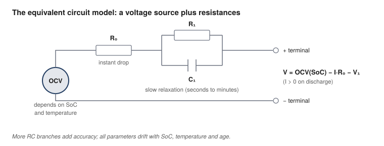

*Figure A4. The equivalent circuit model: a voltage source that depends on SoC, an instant resistance R₀ and an RC branch for slower effects.*

Illustrative LFP cell with V\_max = 3.65 V and an internal resistance of 1 mΩ (assumed values):

| Situation | OCV | Allowed charging current | For a 280 Ah cell |
| --- | --- | --- | --- |
| Mid SoC | 3.30 V | (3.65 − 3.30) ÷ 0.001 = 350 A | 1.25C |
| Near full | 3.45 V | 200 A | about 0.7C |
| Almost full | 3.60 V | 50 A | about 0.2C |
| Mid SoC, cold (resistance doubled to 2 mΩ) | 3.30 V | 175 A | about 0.6C |

This is the CC-CV profile seen from inside the cell (Figure A5): the charger holds the current constant until the terminal voltage reaches its limit, after which the current must fall as the OCV rises. The same arithmetic with a minimum voltage limits discharge power near empty. Resistance also costs energy: at 140 A (0.5C) and 1 mΩ the cell turns 140² × 0.001 ≈ 20 W into heat while delivering about 460 W, roughly 4% in each direction, and the share grows with current. For a site this means that the power a battery can promise depends on its state of charge and temperature, and that fast use costs efficiency.

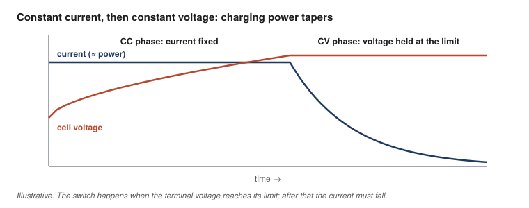

*Figure A5. Constant-current, constant-voltage charging (illustrative): current, and so power, tapers once the voltage limit is reached.*

## A.4 How batteries age

Batteries lose capacity (capacity fade) and gain internal resistance (power fade) through two routes: **calendar ageing**, which happens even at rest and is faster at high temperature and high SoC, and **cycle ageing**, which depends on how much and how hard the battery is used. The main mechanisms are:

- **Growth of the solid electrolyte interphase (SEI)**, a layer on the anode that slowly consumes lithium and raises resistance.
- **Lithium plating**, the deposition of metallic lithium on the anode during fast charging or charging at low temperature, which reduces capacity and can create safety risks ([review, MDPI Energies 2024](https://mdpi.com/1996-1073/17/23/5930)).
- **Mechanical and cathode degradation**, such as particle cracking and loss of active material.

| Stress factor | Effect |
| --- | --- |
| High temperature | Faster calendar and cycle ageing |
| Long periods at high SoC | Faster calendar ageing |
| High charging power, especially when cold | Lithium plating, faster capacity loss |
| Deep cycles and high throughput | Faster cycle ageing |

Capacity fade is usually gradual at first, steady or even slowing, then can accelerate sharply after a "knee", which makes long-term prediction hard ([Attia et al., review of knees in ageing trajectories](https://arxiv.org/abs/2201.02891)). End of life is usually defined at 70–80% of original capacity; retired EV batteries are then candidates for second-life storage, although varied health, diagnostics and falling new-battery prices limit the business case ([review, 2023](https://pmc.ncbi.nlm.nih.gov/articles/PMC10339184)).

### Why ageing slows down, then can speed up

SEI growth is limited by how fast reactants pass through the film that already exists, so it slows as the film thickens, and capacity loss from SEI grows roughly with the square root of time ([von Kolzenberg, Latz & Horstmann](https://publikationen.bibliothek.kit.edu/1000128526/99502733)). Illustratively, a cell that loses 2% in its first year to this mechanism alone would lose about 2% × √4 = 4% after four years, not 8%. A high state of charge accelerates it, because a full graphite electrode sits at a low potential where electrolyte reduction is faster; calendar-ageing tests led Keil et al. to conclude that high storage SoC should be avoided to maximise battery life ([Journal of The Electrochemical Society, 2016](https://mediatum.ub.tum.de/doc/1651485/document.pdf)). Later in life, other mechanisms such as lithium plating or loss of active material can take over and produce the knee (Figure A6). For a site that keeps its battery nearly full to guarantee peak support (Chapter 8), this is a direct trade-off: readiness costs calendar life.

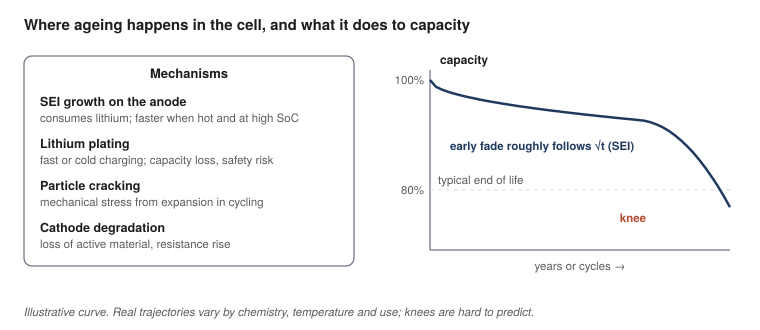

*Figure A6. Ageing mechanisms and an illustrative capacity trajectory: gradual √t-like fade, then a knee.*

## A.5 Safety

The main hazard is **thermal runaway**: a self-heating chain reaction that can lead to fire and spread between cells. LFP is generally more thermally stable than nickel-rich chemistries. Incidents have become much rarer: the annual failure rate per deployed GWh of battery storage fell 98% between 2018 and 2025, and is now comparable to that of large oil-filled transformers ([EPRI, 2026](https://restservice.epri.com/publicdownload/000000003002034920/0/Product)). Large incidents still occur, such as the January 2025 fire at the Moss Landing facility in California ([Facilities Dive](https://www.facilitiesdive.com/news/battery-system-failures-fell-98-in-7-years-but-older-systems-need-special/832966/)), which keeps safety, siting and permitting central for site projects.

**How thermal runaway unfolds.** Runaway is a chain of reactions in which each step releases heat that triggers the next (Figure A7). Decomposition of the SEI has an onset around 80 °C, possibly lower; at roughly 100–120 °C the electrolyte decomposes and the separator begins to melt, releasing gases ([Advanced Energy and Sustainability Research, 2021](https://eprints.soton.ac.uk/448068/1/aesr.202000059.pdf)). Polymer separators melt or shrink at around 120–150 °C, which lets the electrodes touch, and at high temperature some cathodes release oxygen that feeds combustion; NCA and NMC are more prone to this than LFP ([Sandia tutorial, 2026](https://www.sandia.gov/app/uploads/sites/163/2026/06/T1_Johnson_Nathan_Tutorial_260513-v3.pdf)). Battery system design aims to stop the chain early (BMS limits, cooling, fuses) and to stop it spreading from cell to cell.

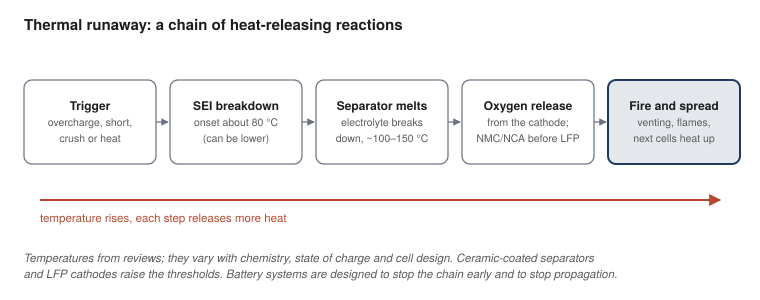

*Figure A7. The thermal runaway chain, with temperatures from the reviews cited; actual values depend on chemistry, state of charge and cell design.*

## A.6 How batteries are modelled

| Model type | Idea | Typical use | Trade-off |
| --- | --- | --- | --- |
| Simple energy ("bucket") model | Energy in, energy out, with efficiency and limits | Sizing studies, optimisation (MILP) | Fast, but ignores voltage, power limits near full or empty, and ageing |
| Equivalent circuit model | Voltage source plus resistors and RC branches | BMS, state estimation, control | Fast and practical; parameters change with SoC, temperature and age |
| Physics-based electrochemical models (DFN, SPM, SPMe) | Equations for lithium transport and reactions in electrodes and electrolyte | Cell design, fast-charging and degradation studies | Accurate but complex; many parameters |
| Empirical ageing models | Fitted relations between stress factors and capacity loss | Lifetime and warranty estimates | Simple; extrapolate poorly |
| Data-driven and physics-informed models | Machine learning, alone or combined with physics | SoH estimation, lifetime prediction | Promising; lab-to-field gap remains (Sections 5.1, 6.2) |

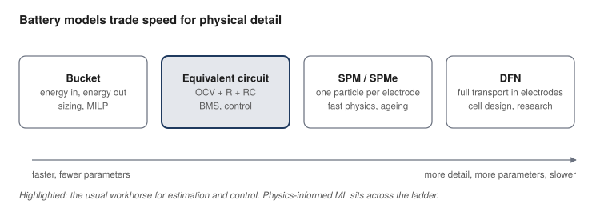

*Figure A8. The model ladder: each step adds physical detail and parameters, and costs speed.*

The Doyle–Fuller–Newman (DFN) model and its simplifications, the single particle model (SPM) and SPM with electrolyte (SPMe), form a family that can be derived systematically from one another ([Brosa Planella et al., Progress in Energy, 2022](https://arxiv.org/abs/2203.16091)). The open-source [PyBaMM](https://docs.pybamm.org/en/stable/source/api/models/index.html) library implements SPM, SPMe, DFN and equivalent circuit models. State estimation commonly combines current counting with model-based observers such as Kalman filters or moving-horizon estimators; at TU Delft, Ferrari's group develops moving-horizon estimators for real-time SoC and parameter estimation ([IEEE TCST, 2026](https://doi.org/10.1109/TCST.2026.3650897)).

### How a BMS estimates state of charge

The simplest method is coulomb counting: the SoC at the next step equals the SoC now minus current times time step, divided by capacity. It is exact in theory but drifts in practice. A current-sensor offset of 0.1 A on a 280 Ah cell adds 2.4 Ah of error per day, almost 1% of SoC (illustrative), and the capacity in the denominator shrinks as the battery ages.

Model-based observers correct the drift (Figure A9). A Kalman filter predicts the SoC by counting charge, predicts the terminal voltage with the equivalent circuit model, compares it with the measured voltage, and corrects the SoC in proportion to the difference, weighting prediction and measurement by their uncertainty. The correction only works if voltage carries information about SoC. On a sloping NMC curve, a few millivolts of voltage error correspond to a small SoC error. On the flat LFP plateau, the same error is ambiguous, so the estimate relies on counting until the battery reaches a steep region near full or empty. This is the technical root of the LFP SoC problem described in Section 5.1.

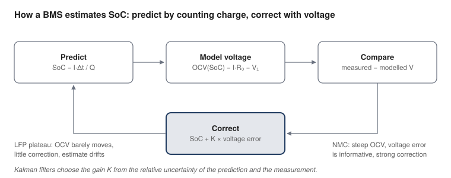

*Figure A9. State-of-charge estimation as a predict-and-correct loop, the structure of a Kalman filter.*

## A.7 State of the art and open problems

- **Better state estimation for LFP**, where flat voltage curves make SoC estimation the weak point.
- **Lifetime prediction from limited data**, including physics-informed and transfer-learning methods (Chapter 6), and early prediction of cycle life from the first cycles ([Severson et al., Nature Energy, 2019](https://doi.org/10.1038/s41560-019-0356-8)).
- **Closing the lab-to-field gap**, since field batteries see irregular use, partial cycles and incomplete sensor data.
- **Fast charging without lithium plating**, using model-based charging protocols.
- **New chemistries**, notably sodium-ion now, with solid-state batteries under development.
- **Data access and traceability.** EU rules require battery management systems of stationary storage and EV batteries to give access to state-of-health data, and industrial batteries above 2 kWh need a digital battery passport from February 2027 ([Regulation (EU) 2023/1542](https://eur-lex.europa.eu/eli/reg/2023/1542/oj/eng); Section 13.7).

## A.8 EV batteries in depth

**Architecture.** Passenger EV packs typically store tens of kilowatt-hours, up to around 100 kWh; heavy trucks carry several hundred kilowatt-hours, for example around 600 kWh ([innobu, 2026](https://www.innobu.com/en/articles/mcs-megawatt-charging-e-trucks-2026.html)). Most cars use a 400 V architecture; a growing number use 800 V, which halves the current for the same power and reduces heat, helping sustain high charging power ([soyacincau](https://soyacincau.com/2023/10/01/what-is-ev-charging-curve-dc-fast-charging-80-percent-lta-128/)).

**How an EV charges.** The vehicle's BMS, not the charger, decides how much power it accepts at each moment, based mainly on SoC, temperature and chemistry. Most EVs accept their highest power at low SoC, reduce it towards 80%, and slow sharply from 80 to 100% ([EVKX](https://evkx.net/dictionary/charge-curve)). Peak power is therefore not average power: a car advertised at 400 kW may average much less over a session. Cold batteries charge slower unless preconditioned.

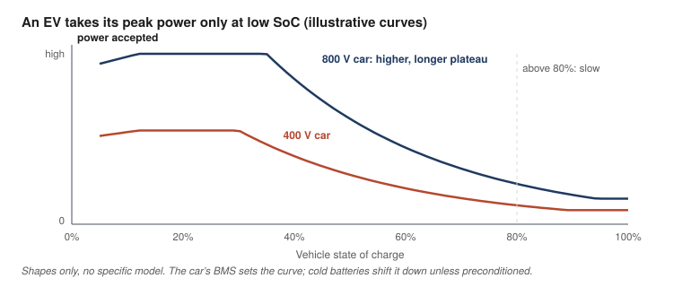

*Figure A10. Illustrative EV charging curves: the BMS allows peak power only at low SoC, and an 800 V car typically sustains high power longer.*

**Worked example (illustrative).** A car with a 75 kWh usable battery arriving at 10% and leaving at 80% needs 0.7 × 75 = 52.5 kWh. If its average power over that window is 120 kW, the session takes about 26 minutes; if the site caps the charger at 60 kW during a peak, about 53 minutes. Stopping at 80% avoids the slowest part of the curve. For site planning, energy per session follows from battery size and SoC window, while the power actually drawn follows from the car's curve and the charger, not from the charger's rating alone.

**Heavy-duty charging.** The Megawatt Charging System (MCS) allows up to 3.75 MW per charger (3,000 A at 1,250 V) and was published as IEC TS 63379 in February 2026 ([innobu, 2026](https://www.innobu.com/en/articles/mcs-megawatt-charging-e-trucks-2026.html)). A site with a few MCS chargers can draw several megawatts, comparable to a small industrial customer, which makes batteries and flexibility central to truck charging.

**Real-world degradation.** A Geotab study of over 22,700 EVs found average capacity loss of 2.3% per year, implying about 81.6% of original capacity after eight years. Vehicles using DC fast charging above 100 kW frequently degraded up to 3.0% per year, against about 1.5% for mainly lower-power charging; hot climates added about 0.4% per year, and vans degraded faster than cars ([Geotab, 2026](https://www.geotab.com/press-release/ev-battery-health-degradation-fast-charging-study/)).

**Vehicle-to-grid (V2G).** Studies on whether V2G harms EV batteries often conflict ([arXiv 2603.10880](https://arxiv.org/abs/2603.10880)). Physics-based simulation suggests the answer depends on the dominant ageing mechanism: load-shifting V2G looks most favourable for batteries whose ageing is dominated by calendar ageing, which happens anyway while the car is parked ([arXiv 2408.02139](https://arxiv.org/abs/2408.02139)).

### How a site controller talks to chargers and cars

A charging session is governed by a chain of limits (Figure A11). The charging station communicates with its backend, the charging station management system (CSMS), through the Open Charge Point Protocol (OCPP). Smart charging in OCPP works with **charging profiles**: schedules of power or current limits over time, in W or A. OCPP 2.0.1 defines four purposes for them: ChargingStationMaxProfile (a limit for the whole station), ChargingStationExternalConstraints (limits set by an external system), TxDefaultProfile (the default for new sessions) and TxProfile (a limit for one running session) ([OCPP 2.0.1 schema](https://cdn.jsdelivr.net/npm/ocpp-messages@0.2.5/v2.0/SetChargingProfileRequest.d.ts)). Within a purpose, a profile with a higher stack level takes precedence over a lower one ([OCPP 2.0.1 message reference](https://josev-api.ecog.io/v3.1.0/internal_messages/set_charging_profile)).

Between the charger and the car, ISO 15118 carries information such as the car's energy needs and, in ISO 15118-20, supports bidirectional charging and Plug & Charge. Delegated acts under the EU's AFIR regulation require new and renovated chargers to support ISO 15118-20 ([European Alternative Fuels Observatory](https://alternative-fuels-observatory.ec.europa.eu/node/1175); [AFIR](https://eur-lex.europa.eu/eli/reg/2023/1804)). Even with these protocols, the car's BMS has the last word: it accepts power only up to its own charging curve.

For this research, the chain explains why EV flexibility is uncertain at the site level: the controller sets a limit, but the delivered power depends on the car's state of charge, temperature and BMS behaviour, which the site observes only partly unless ISO 15118 data are available.

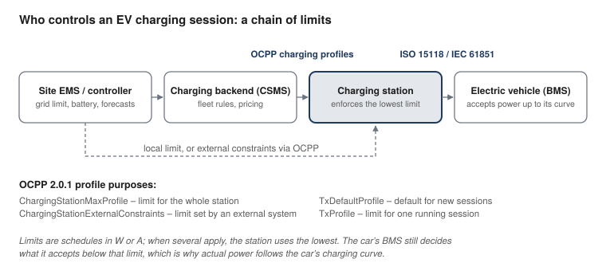

*Figure A11. The chain of limits in an EV charging session, from site controller to the car's BMS.*

## A.9 What this means for site flexibility

1. **Nameplate is not promisable.** Usable capacity is lower than nameplate, and SoC uncertainty (especially for LFP) means a site should promise less than its battery appears to hold, unless uncertainty is modelled explicitly.
2. **Flexibility depends on state.** Power available for the grid shrinks near full or empty and in cold weather, so promised flexibility should vary with SoC and temperature.
3. **Size for the end of the contract.** Capacity fades over the years, so a battery sized for day one may fail its promise later. Heavy cycling for trading accelerates this.
4. **Model EV charging as the BMS sees it.** Charging power tapers with vehicle SoC and depends on temperature and architecture; arrival SoC and battery size drive energy demand.
5. **Megawatt peaks are coming.** Truck charging creates very high, short peaks, which is where site batteries and contract-aware control can add much value.
6. **Chemistry and supply matter.** LFP dominates stationary storage, sodium-ion is emerging, and most cells come from China (Section 13.7).
7. **Data is becoming available.** EU rules on BMS data access make SoH-aware planning and control more feasible.
