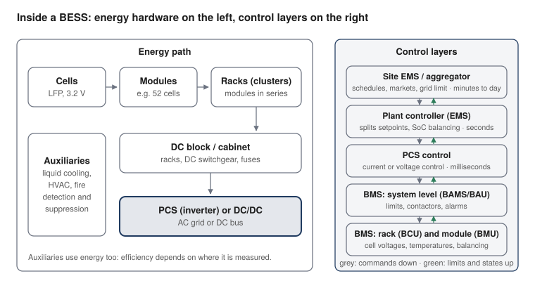
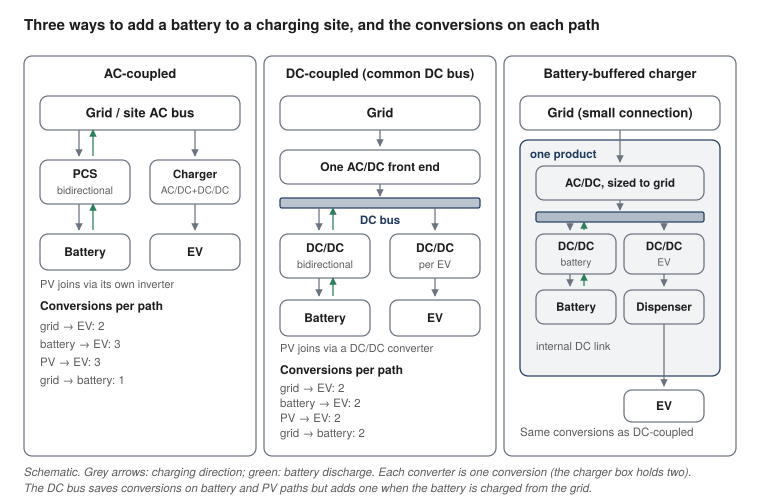
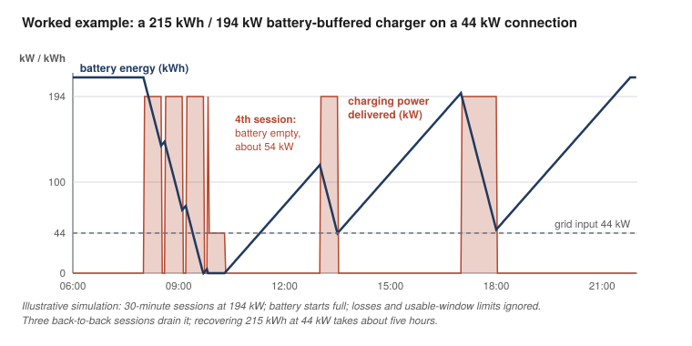
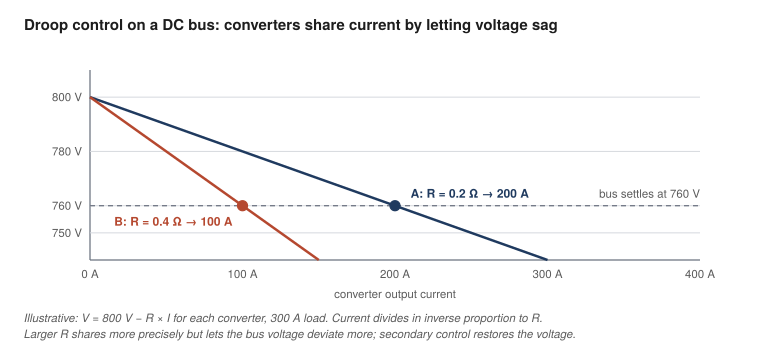

# Appendix B. Battery energy storage systems (BESS), with a focus on DC-coupled storage for EV charging

**In simple terms.** A BESS is far more than a box of cells. It adds power electronics to connect the cells to the grid or to a DC bus, a battery management system, cooling, fire protection and an energy management system that decides when to charge and discharge. It can be connected on the AC side of a site (AC-coupled) or share a DC bus with solar panels and EV chargers (DC-coupled). Most of the world's BESS cells and systems now come from Chinese companies. This appendix explains how the systems are built, who makes them, how they are controlled, and what is hard about using them at EV charging sites.

## B.1 What a BESS is made of

A BESS has an energy path and a control stack (Figure B1):

- **Cells, modules, racks and the DC block.** Cells are assembled into modules, modules into racks (also called clusters), and racks into a DC block: a cabinet or container with DC switchgear and fuses. More than 90% of stationary storage batteries now use LFP cells (Appendix A.2); for years the standard storage cell was 280 Ah, then 314 Ah ([Benchmark Mineral Intelligence](https://source.benchmarkminerals.com/article/byd-unveils-2710ah-cell-for-new-haohan-storage-system)), and the newest products use cells of 500 Ah and more (B.4).
- **Power conversion system (PCS).** A bidirectional inverter connects the DC block to the AC grid; in a DC-coupled system a DC/DC converter connects it to a DC bus instead (B.2). Utility products are sold either as **DC blocks**, with the PCS supplied separately, or as **AC blocks** that integrate battery and PCS: Tesla's Megapack includes the inverter, whereas CATL's TENER is shown without one ([Electrek](https://electrek.co/?p=358380)), and Sungrow's PowerTitan 3.0 is an AC block ([Energy-Storage.news](https://www.energy-storage.news/?p=80622)).
- **Battery management system.** In stationary systems the BMS is commonly built in three tiers: a battery management unit (BMU) monitors cell voltages and temperatures in each module, a rack-level controller (BCU, sometimes BCMU) handles safety and charging management, and a system-level unit (BAMS or BAU) communicates with the PCS and the energy management system ([Texas Instruments](https://www.ti.com/document-viewer/lit/html/TIDUFD1/GUID-F93127E4-6DD9-4143-9A74-FE28B357F2F5)). Inside the BMS, communication traditionally runs over CAN ([patent description](https://image-ppubs.uspto.gov/dirsearch-public/print/downloadPdf/12541183)).
- **Energy management system (EMS)** and **environmental control**: the EMS decides setpoints; an environmental control system combines HVAC and fire systems to keep the container stable ([Advantech via DigiKey](https://www.digikey.com/en/ptm/a/advantech/battery-energy-storage-system-bess-solutions/tutorial?slide=5)). The utility containers in B.4 and most of the C&I cabinets cited here use liquid cooling; Huawei's C&I cabinet uses a hybrid cooling design.

*Figure B1. The parts of a BESS: the energy path from cells to the power converter, and the control layers from the cell-level BMS up to the site EMS.*

**Worked example: reading a C&I cabinet.** A common commercial and industrial format is the 125 kW / 261 kWh liquid-cooled cabinet, offered by many Chinese suppliers, among them Hithium, GoodWe, AlphaESS and SolaX ([GoodWe](https://en.goodwe.com/goodwe-launches-125kw-261kwh-all-in-one-liquid-cooled-energy-storage-solution-for-ci); [pv magazine](https://www.pv-magazine.com/2025/09/19/alphaess-releases-liquid-cooled-ess-for-commercial-and-industrial-use/); [SolaX](https://solaxpower.com/uploads/file/solax-ess-trene-liquid-cooling-datasheet-en.pdf)). Hithium's version holds 314 Ah LFP cells, has a nominal DC voltage of 832 V (operating range 715–923 V), a nominal rate of 0.5P and CAN, RS485 and Ethernet interfaces ([Hithium datasheet](https://www.hithium.com/bocupload/2025/08/01/1754035081192pl15d.pdf)). The numbers fit together: such cabinets connect 260 cells in series, in five modules of 52 ([Suntech datasheet](https://www.suntech-power.com/download/STE-261L-125P_EN.pdf)), so 260 × 3.2 V = 832 V and 832 V × 314 Ah ≈ 261 kWh. At 125 kW the cabinet runs for about two hours (125 ÷ 261 ≈ 0.48C). The nameplate is not all usable: APsystems' 261 kWh cabinet lists 235 kWh of usable capacity ([APsystems datasheet](https://solarmagazine.nl/u/webshop/apsystemsdatasheetapstorage261l.pdf)), about 90%.

## B.2 AC-coupled and DC-coupled

In an **AC-coupled** site, the battery has its own PCS and connects to the site's AC bus, like any other load or generator; each charger has its own AC/DC rectifier and DC/DC stage. In a **DC-coupled** site, one AC/DC front end feeds a common DC bus; the battery, solar panels and each EV connect to the bus through DC/DC converters. A review of charging architectures notes that common-DC-bus stations use a single AC-DC converter with an independent DC-DC converter per EV, and are generally more efficient, compact and flexible, also for connecting storage and renewables, but the low operating power factor of DC-bus stations can cause harmonic problems on the grid ([arXiv 2209.15242](https://arxiv.org/abs/2209.15242)). A third variant is the **battery-buffered charger**, which puts a small grid converter, a battery and the charging electronics in one product (B.3).

*Figure B2. AC-coupled, DC-coupled and battery-buffered charging, with the number of power conversions on each energy path.*

**Worked example: counting conversions (illustrative).** Assume every conversion stage is 98% efficient. In the AC-coupled site, energy from the battery to an EV passes three stages (PCS, charger rectifier, charger DC/DC): 0.98³ ≈ 94.1%. In the DC-coupled site it passes two (battery DC/DC, EV DC/DC): 0.98² ≈ 96.0%. The same two-against-three advantage holds for solar energy going to EVs. But when the battery is charged from the grid, the DC-coupled path has one stage more (front end plus battery DC/DC, against the PCS alone), so for grid energy stored and later delivered to an EV both sites pass four stages: 0.98⁴ ≈ 92.2%. The efficiency gain of DC coupling is therefore real mainly where much energy flows from solar or from the battery directly to the vehicles; some research designs remove a stage by connecting battery strings to the other DC components through a busbar matrix, without interfacing converters ([DTU, arXiv 2112.00351](https://arxiv.org/abs/2112.00351)).

The larger structural advantage is **sizing**: in a DC-coupled design the grid-facing converter only needs to match the grid connection, while the battery and EV converters are sized for the charging power. The drawbacks are practical: a review of DC fast-charging stations notes that the lack of standards for protection and metering has so far limited the spread of DC-bus designs ([KIT review](https://publikationen.bibliothek.kit.edu/1000174594/154886593)); integrated products tie the site to one vendor; and the DC bus must serve both 400 V and 800 V vehicles.

## B.3 Battery-buffered chargers and DC storage for charging

Several products already bring DC-coupled storage to charging sites:

| Product | Battery | Grid input | Charging output | Notes |
| --- | --- | --- | --- | --- |
| ADS-TEC Energy ChargeBox | 140 kWh | 39–110 kVA at 400 V | up to 320 kW | Up to 300 m between grid connection and charging point ([datasheet](https://www.solarics.de/cdn/shop/files/ADS_TEC_Energy_data_sheet_ChargeBox_EN.pdf)) |
| ADS-TEC Energy ChargePost | 144–201 kWh | 22–87 kW (201 kWh version) | up to 300 kW | Two charging points, advertising screens ([electrive](https://www.electrive.com/2022/12/02/ads-tec-energy-launches-sales-of-battery-boosted-chargepost); [pv magazine](https://www.pv-magazine.de/produkte/xxx-ads-tec-energy-schnellladestation-mit-batteriespeicher-und-weiteren-erloesen/)) |
| XCharge GridLink (Europe) | 215 kWh LFP, scalable to 430 kWh | max. 44 kW | up to 194 kW | In-house battery; OCPP 1.6J and 2.0.1; can run during grid outages ([electrive](https://www.electrive.com/2025/09/02/from-the-us-to-europe-xcharge-brings-gridlink-to-berlin); [Charged EVs](https://chargedevs.com/newswire/xcharge-launches-gridlink-in-europe-powered-by-proprietary-battery-technology/)) |
| Huawei FusionCharge power unit | external DC ESS | site connection | up to 720 kW per unit, 500 A per connector | Power unit has DC buses reserved for coupling with DC storage ([pv magazine](https://www.pv-magazine.com/2025/11/20/huawei-unveils-next-generation-solutions-for-ci-energy-and-e-mobility); [Huawei](https://digitalpower.huawei.com/eg/smart-charging-network/ultra-fast-charging)) |

Field results show the principle: a site built by energielösung GmbH with a 125 kW grid connection runs a 300 kW ChargePost, which needs only 22 to 87 kW of input, alongside two conventional chargers ([Business Wire, 2026](https://www.businesswire.com/news/home/20260507148739/en/)).

**Worked example: how long does the buffer last? (illustrative)** Take a GridLink-type unit: 215 kWh, 194 kW out, 44 kW in. At full output the battery drains at 194 − 44 = 150 kW, so a full battery sustains full power for about 215 ÷ 150 ≈ 1.4 hours; refilling it at 44 kW takes about 215 ÷ 44 ≈ 4.9 hours. A 30-minute session at 194 kW delivers 97 kWh, of which the grid supplies 22 kWh and the battery 75 kWh. Figure B3 simulates a day with seven such sessions: three back-to-back morning sessions empty the battery, and the fourth runs at roughly grid power, about 54 kW on average. Whether such a unit serves a site well depends on the timing and clustering of arrivals, not on the average demand: exactly the kind of question the probabilistic methods of Chapters 4, 7 and 8 answer.

*Figure B3. Simulated day of a battery-buffered charger: delivered charging power and battery energy. Losses and the usable SoC window are ignored.*

## B.4 Main providers, especially from China

**Market structure.** Chinese system integrators held 76% of the global BESS market in 2025, and eight of the ten largest integrators are headquartered in China; by Wood Mackenzie's count Tesla and Sungrow kept the first two places and BYD rose to third ([Wood Mackenzie, 2026](https://www.woodmac.com/press-releases/2026-bess-market-share-chinese-integrators-76-percent-global-dominance-2025/)). Benchmark Mineral Intelligence, with a different method, ranks BYD first with 13% of the market ahead of Tesla with 10%, followed by Sungrow, CRRC Zhuzhou, CATL and HyperStrong ([Electrek, citing Benchmark](https://electrek.co/?p=467178)); rankings depend on how shipments are counted. In Europe, Sungrow was first, BYD second and Huawei third, all Chinese ([Wood Mackenzie](https://www.woodmac.com/zh/press-releases/2026-bess-market-share-chinese-integrators-76-percent-global-dominance-2025/)).

For cells, global storage-cell shipments reached 612 GWh in 2025, and CATL, Hithium, EVE Energy, BYD, CALB and REPT BATTERO held the top six places with close to 75% of the market ([InfoLink](https://www.ess-news.com/2026/02/09/infolink-2025-energy-storage-cell-shipments-jump-95-to-612-gwh-as-market-flips-from-glut-to-tightness/)). CATL shipped 121 GWh, a 20% share ([Benchmark via Energy-Storage.news](https://www.energy-storage.news/2025-bess-cell-and-system-shipments-byd-takes-bess-crown/)). Prices reflect this concentration: the global average turnkey BESS price in 2025 was $117/kWh, with China at $73/kWh, Europe at $177/kWh and the US at $219/kWh ([BloombergNEF via Energy-Storage.news](https://www.energy-storage.news/battery-storage-system-prices-continue-to-fall-sharply-bnef-and-ember-reports-find/)).

| Company | Role | Characteristic products and claims |
| --- | --- | --- |
| CATL | Largest storage-cell maker; absent from Wood Mackenzie's integrator ranking because it operates mainly as a cell supplier, while Benchmark counts its system shipments (6%) ([Energy-Storage.news](https://www.energy-storage.news/chinese-system-integrators-capture-76-of-global-bess-market-as-competition-intensifies/)) | TENER: 6.25 MWh per 20-foot container with a claimed five years of zero degradation; TENER Stack: 9 MWh using 587 Ah LFP cells ([Energy-Storage.news](https://www.energy-storage.news/catl-unveils-five-year-zero-degradation-bess-with-6-25mwh-per-container/); [Battery Design](https://www.batterydesign.net/catl-unveils-9mwh-system-redefining-utility-scale-storage/)) |
| BYD | Vertically integrated: cells, packs and systems | MC Cube-T: 6.432 MWh with cell-to-system design ([Gasgoo](https://news.metal.com/newscontent/102710499-BYD-launches-all-new-energy-storage-system-MC-Cube-T)); Haohan: 14.5 MWh with a 2,710 Ah blade cell ([Benchmark](https://source.benchmarkminerals.com/article/byd-unveils-2710ah-cell-for-new-haohan-storage-system)); a 2.3 MWh sodium-ion container at 1,200 V nominal ([Energy-Storage.news](https://www.energy-storage.news/byd-launches-sodium-ion-grid-scale-bess-product)) |
| Sungrow | Inverter maker turned integrator; storage was 42% of its 2025 revenue ([Energy-Storage.news](https://www.energy-storage.news/chinese-system-integrators-capture-76-of-global-bess-market-as-competition-intensifies/)) | PowerTitan 3.0: AC block (battery and PCS in one unit), 6.9 MWh in 20 feet, 684 Ah and 661 Ah stacked cells, liquid-cooled silicon-carbide PCS, one PCS per rack, grid-forming ([Energy-Storage.news](https://www.energy-storage.news/sungrow-launches-powertitan-3-0-with-modular-design); [Sungrow](https://www.sungrowpower.com/en/newsDetail/6652/sungrow-unveils-powertitan-3-0-redefining-utility-scale-energy-storage-for-mea)); PowerStack C&I cabinet: 257 kWh, 314 Ah cells, 256 in series ([datasheet](https://info-support.sungrowpower.com/application/pdf/2025/06/05/DS_20250416_ST255CS-2H-US_Datasheet_V1_EN.pdf)) |
| Huawei Digital Power | Power electronics, "smart string" storage, chargers | LUNA2000-215: 215 kWh C&I cabinet, 0.5 CP, maximum cycle efficiency 91.3% at rated conditions, grid-forming ([Huawei](https://solar.huawei.com/ae-en/products/LUNA2000-215-Series/specs/)); FusionCharge with DC storage coupling (B.3) |
| Hithium | Second-largest storage-cell maker in 2025 | Signed a five-year, 120 GWh supply agreement with integrator CRRC ([Energy-Storage.news](https://www.energy-storage.news/2025-bess-cell-and-system-shipments-byd-takes-bess-crown/)); 125 kW / 261 kWh C&I cabinet (B.1) |
| CRRC Zhuzhou, HyperStrong, Envision | Integrators | Led the Asia-Pacific ranking in that order ([Wood Mackenzie](https://www.woodmac.com/es/press-releases/2026-bess-market-share-chinese-integrators-76-percent-global-dominance-2025/)) |
| EVE Energy, CALB, REPT BATTERO | Cell suppliers | Among the top six storage-cell makers (above) |

Three technical trends stand out. **Cells are getting much larger**, from 314 Ah to 587–684 Ah and even 2,710 Ah, which means fewer cells and connections per MWh but more energy in each cell that can fail; Benchmark notes that the size of BYD's cell and system raises questions over practical deployment. **Containers hold more energy**: 5 MWh per 20-foot container had become standard ([Energy-Storage.news](https://www.energy-storage.news/byd-launches-sodium-ion-grid-scale-bess-product)), and the products above reach 6.25–6.9 MWh, with 9 MWh in CATL's stacked design. **Power electronics move closer to the racks**: Sungrow assigns one PCS per rack to avoid state-of-charge imbalance between racks ([Sungrow via Zawya](https://www.zawya.com/en/press-release/companies-news/sungrow-unveils-powertitan-30-w4u2tg9g)).

## B.5 How to read a BESS datasheet

| Parameter | What it means | What to check |
| --- | --- | --- |
| Nominal vs usable energy | Nameplate kWh vs what may be used | Usable energy at the end of the warranty, not at delivery; in one test campaign, the depth of discharge of lithium-ion systems was restricted to 72–85%, delivering 63–85% of rated energy ([PNNL](https://www.pnnl.gov/main/publications/external/technical_reports/PNNL-29378.pdf)) |
| C-rate or P-rate | Power relative to energy (0.5P = full in about two hours) | Whether full power holds across the SoC range and temperature |
| DC voltage range | e.g. 715–923 V for a 260-cell string | Compatibility with the PCS, the DC bus and 800 V vehicles |
| Round-trip efficiency | Energy out divided by energy in | At which point (DC or AC) and with or without auxiliary consumption; PNNL reports both, because they differ |
| Cycle life and degradation warranty | e.g. 12,500 cycles claimed for Sungrow's 661 Ah cell ([North American Clean Energy](https://www.nacleanenergy.com/solar/next-generation-ac-block-energy-storage-system)); CATL's zero-degradation claim | Test conditions behind the claim; throughput caps and temperature limits in the warranty |
| Operating temperature | e.g. −30 to 55 °C with derating above 50 °C for Huawei's LUNA2000-215 | How much power is lost at the site's real temperatures |
| Interfaces and controls | CAN, RS485, Ethernet; Modbus or IEC 61850 | Which limits and states the BMS exposes, and how fast |
| Grid-forming | Ability to set voltage rather than follow it (B.6) | Whether the PCS supports it; the draft RfG 2.0 introduces grid-forming requirements for storage |
| Safety certification | IEC 62619 for cells and packs; UL 9540A fire test results | Test edition and installation-level results (B.7) |

## B.6 How a BESS is controlled

**Layers and time scales.** Control is hierarchical (Figure B1). The BMS protects and estimates within milliseconds to seconds and publishes limits: the maximum charge and discharge power allowed now, which depend on SoC, temperature and cell imbalance (Appendix A.3). The PCS controls current or voltage within milliseconds. A plant controller splits setpoints among racks or units and balances their SoC. The site EMS or an aggregator sets schedules from forecasts, prices and the grid limit, over minutes to days. A recurring integration problem is that the EMS must always stay inside the limits the BMS publishes: if the EMS asks for 125 kW of discharge at 8% SoC and the BMS allows only 40 kW (illustrative numbers), the PCS delivers 40 kW, and the EMS's plan is wrong from that moment.

**Grid-following and grid-forming.** A grid-following inverter controls its output current and needs another source to synchronise to; a grid-forming inverter controls its output voltage and can create its own waveform ([NREL](https://nrel.gov/docs/fy24osti/90256.pdf)). The draft revision of the EU Network Code on Requirements for Generators (RfG 2.0) introduces grid-forming requirements for non-synchronous generation and electricity storage modules ([ENTSO-E](https://entsoe.eu/news/2025/11/04/entso-e-publishes-phase-ii-technical-report-on-grid-forming-requirements)); the Commission plans to publish the final version by early 2027 at the latest ([VDE](https://www.vde.com/de/fnn/aktuelles/rfg2026-stellungnahme)).

**Communication.** Inside the system, the BMS tiers commonly talk over CAN. Externally, BESS gateways commonly support Modbus, IEC 61850, DNP3 and IEC 60870-5-104 ([Advantech via DigiKey](https://www.digikey.com/en/ptm/a/advantech/battery-energy-storage-system-bess-solutions/tutorial?slide=5)). SunSpec defines Modbus register maps for storage aligned with the IEC 61850-7-420 information model ([SunSpec](https://sunspec.org/wp-content/uploads/2019/08/SunSpec-Alliance-Specification-Energy-Storage-ModelsD4rev0.pdf)), and the MESA-ESS specification has become IEEE Std 1815.2 ([PNNL, 2026](https://doepeerreview.sandia.gov/app/uploads/sites/82/2026/07/401_Kolln_Jaime_Interoperability-and-Reliability-Codes-and-Standards.pdf)). Even so, PNNL notes that the diversity of communication standards raises integration costs and causes interoperability problems ([PNNL, 2025](https://www.pnnl.gov/publications/interoperable-energy-storage-control-and-communication-framework-development)).

**Controlling a DC bus.** In a DC-coupled site the first control task is keeping the DC bus voltage stable while sharing current between the grid front end, the battery converter and the chargers. A widely used method is **droop control**: each converter lowers its voltage reference in proportion to its output current, like a virtual resistance, so converters share load without fast communication ([arXiv 1504.03016](https://arxiv.org/abs/1504.03016)). The trade-off is fundamental: larger droop resistance gives more accurate current sharing but larger bus-voltage deviation ([arXiv 1701.04419](https://arxiv.org/abs/1701.04419)). A hierarchy of primary, secondary and tertiary control then restores the voltage and optimises the operating point ([Gao et al.](https://keele-repository.worktribe.com/OutputFile/462758)), and droop variants can balance the SoC of several batteries ([FREEDM](https://www.freedm.ncsu.edu/wp-content/uploads/2019/01/Model_Droop_Control_Battery_State.pdf)).

**Worked example: droop sharing (illustrative).** Two converters feed an 800 V bus with droop laws V = 800 − 0.2 × I (converter A) and V = 800 − 0.4 × I (converter B), and the chargers draw 300 A. Both converters see the same bus voltage, so 0.2 × I\_A = 0.4 × I\_B, giving I\_A = 200 A and I\_B = 100 A, and the bus settles at 800 − 0.2 × 200 = 760 V, 5% below nominal (Figure B4). With droop resistances ten times smaller, the deviation would be ten times smaller, but current sharing would become less accurate ([arXiv 1701.04419](https://arxiv.org/abs/1701.04419)). In a battery-buffered charger, the grid converter is limited to the connection power (44 kW in the B.3 example) and the battery supplies the rest; the EMS works on top, shifting setpoints to keep the battery charged for the next peak.

*Figure B4. Droop lines of two converters on a DC bus and the operating point for a 300 A load.*

## B.7 Main challenges

- **Fire safety and permitting.** The sixth edition of UL 9540A adds an installation-level, large-scale fire test after the cell- and module-level tests ([UL Solutions](https://www.ul.com/thecodeauthority/knowledge/understanding-UL-9540A-NFPA-855)), and large-scale fire testing became mandatory in the 2026 edition of NFPA 855 ([Energy-Storage.news](https://www.energy-storage.news/?p=97271)). Datasheets for the European market commonly cite IEC 62619 for cells and battery systems (for example [Billion](https://www.billion.com/ESS/Aqua-A-261kWh)), and IEC 62933-5-2 covers safety of grid-integrated electrochemical storage systems ([UL Solutions](https://www.ul.com/offerings/energy-storage-system-testing-and-certification)).
- **Cybersecurity and supplier risk.** Since April 2026 the Commission's interim guidance bars EU-funded projects from using solar and storage power conversion systems from high-risk countries, from November 2026 for grid-connected projects and April 2027 for off-grid ones ([S&P Global](https://www.spglobal.com/energy/en/news-research/latest-news/electric-power/081326-eu-pv-storage-inverter-funding-ban-could-reflect-shift-toward-clean-energy)). Wood Mackenzie expects this to affect about 12% of EU storage deployments to 2030 ([pv magazine](https://www.pv-magazine.com/2026/07/09/ban-on-high-risk-pv-inverters-to-impact-14-of-eu-solar-demand-to-2030/)), and the IEA notes that Lithuania has restricted remote control of inverters since May 2025 ([IEA](https://www.iea.org/commentaries/inverter-supply-chains-and-cybersecurity)). Concerns focus on remote cloud access by vendors or attackers ([pv-tech](https://www.pv-tech.org/lawmakers-call-for-eu-wide-chinese-inverter-restrictions/)), and European manufacturers argue that inverters and their associated energy and battery management systems are critical ICT assets ([ESMC](https://esmc.solar/download/166/inverter-storage-ems-forum/8768/proposed-amendments-to-the-csa2.pdf)): the risk sits in the control layers more than in the cells.
- **Interoperability and lock-in.** Different protocols and vendor-specific BMS interfaces raise integration cost (B.6); integrated battery-buffered chargers simplify installation but tie the site to one vendor's controls.
- **Usable energy, auxiliary losses and warranties.** Nameplate, usable energy, end-of-warranty energy and auxiliary consumption differ, and claims such as zero degradation or five-figure cycle lives need checking against the warranty terms (B.5).
- **DC-coupled specifics.** Protection and metering standards for DC architectures are less mature (B.2); the DC bus must serve 400 V and 800 V vehicles; and the battery's available power changes with SoC and temperature, so the charging power a buffered site can promise is itself uncertain.
- **Bigger cells, bigger units.** Larger cells and containers reduce the number of parts per MWh but concentrate energy, which matters for fire propagation, transport and site layout.

## B.8 What this means for site flexibility research

1. **DC-coupled charging is where the research questions are sharpest.** Battery state, BMS limits, charger power and the grid limit interact on one DC bus within seconds, so the site model must include the battery's power limits, not only its energy (Appendix A.3).
2. **Sizing is a two-variable problem.** For a buffered site, the grid converter (or contract) and the battery are sized together; the worked example in B.3 shows that arrival clustering, not average demand, decides whether a design works, which calls for the probabilistic sizing of Chapter 8.
3. **Vendor-neutral control has value.** With most hardware coming from Chinese suppliers, different protocols and new EU rules on remote access, a controller that works across vendors, respects their BMS limits and keeps data and control in Europe matches the startup idea discussed in Section 13.7.
